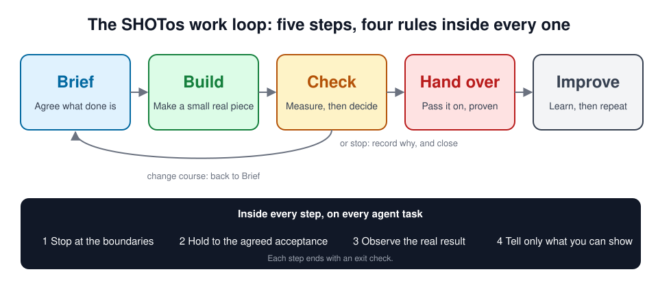
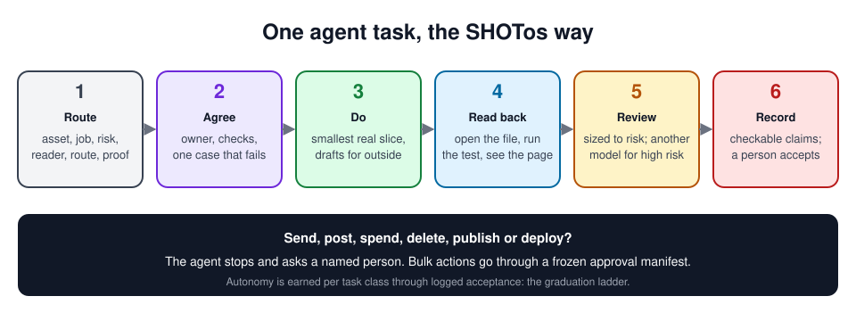
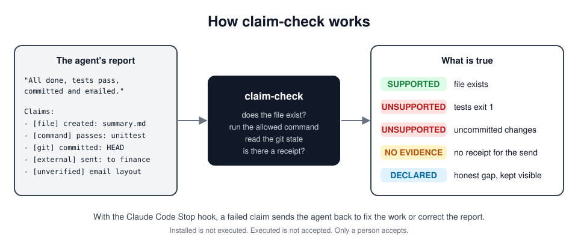
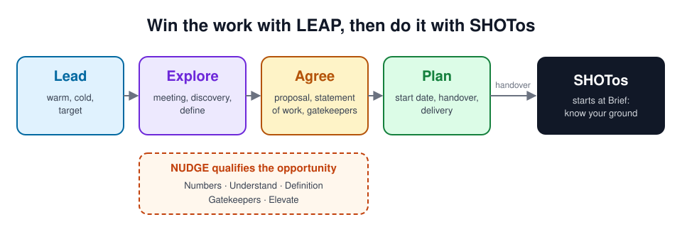

# SHOTos

**A practical operating system for AI-supported work: agree what good looks like, do the work, check the result and report only what the evidence supports.**

SHOTos gives people and AI agents one way to work across product delivery, commercial work and everyday operations. It combines four rules, a five-step work loop, reusable skills and a `claim-check` tool. The rules set boundaries; the skills help with specific jobs; the check tests claims such as “file created”, “tests pass” and “committed”. People still decide what to approve and accept.

**Created by [Liam McDowell](https://github.com/liammcdow). Published by SHOT Clubhouse Limited.**

## Who it helps

| If you are... | Start with... | What it helps you produce |
|---|---|---|
| A founder or small business owner | [Founder guide](docs/guides/startup-founder.md) or [small business guide](docs/guides/small-business.md) | A clear problem, a tested first step, proposals and a manageable weekly brief |
| A COO or business unit leader | [Enterprise operations](docs/guides/enterprise-operations.md) | Named owners, measured baselines, decision briefs and handoffs that another team can use |
| An analyst or product owner | [Agree acceptance](skills/agree-acceptance/README.md) | A brief with real examples, failure cases and a clear decision owner |
| An engineering or practice lead | [Ways of working](ways-of-working/README.md) | Shared checks, reviewable claims and evidence before a handover or release |
| A commercial or customer success team | [Win the work](packs/win-the-work/README.md) or [customer success](packs/customer-success/README.md) | Contextual proposals, opportunity decisions and recoverable onboarding handoffs |

## Try it in a separate project

Python 3.9 or later and git are required. These commands leave your existing projects alone:

```sh
git clone https://github.com/SHOTClubhouse/shotos.git
python shotos/examples/demo/run_demo.py
mkdir shotos-sandbox
cd shotos-sandbox
python ../shotos/install.py --runtime codex --scope project --dry-run
python ../shotos/install.py --runtime codex --scope project
```

Open `shotos-sandbox` in Codex and ask: “Our volunteer rota may take eight hours a week to manage, but we have not measured it. Help us define the problem and the first evidence to gather.” The skill should label the eight hours as an estimate and propose a small baseline before claiming savings. For Claude Code, replace `codex` with `claude` and add `--with-hook` if you want the optional Stop hook. See [all runtimes and packs](#install).

## Ready today

| Available now | Evidence and limit |
|---|---|
| Four rules, five-step loop, 28 core skills and 54 optional pack skills | All are in this repository; use only the skills that fit your job. |
| Installer, `claim-check` and opt-in Claude Code Stop hook | 118 local automated tests pass on Python 3.9 and 3.13. The hook checks claims and completion language; it does not judge the quality of the work. |
| Claude Code use and Codex installation | Claude Code has paired task evals. Two local Codex runs opened installed skills; paired Codex outcomes are untested. |
| Honest evidence | The October outcome eval found no measurable pass-rate gain and about 42% higher model cost with SHOTos. The revised build passed 10/10 against 10/10 without on Sonnet; a preceding Haiku check exposed a real inherited-work failure and a proposal grader error, both investigated and targeted. A current-wording, full-scope Haiku check found method adherence in 206/212 cases with SHOTos versus 162/212 without, before targeted fixes. [Read the methods and results](docs/evidence.md). |

Gemini CLI and Antigravity have install paths but no live run yet. Rework saved across weeks, team adoption and 5x or 10x productivity gains have not been demonstrated. Start with one bounded task and measure the result you actually accept.



## What SHOTos stands for

The four rules spell SHOT: **S**top at the boundaries, **H**old to what you agreed (agree acceptance first), **O**bserve the real result (read it back) and **T**ell only what you can show (claim only what you can show). The os is the operating system around them: the work loop, the skills and the tools.

The work loop has five steps. Each one ends with something you can see and measure, and a named person decides at the end of Check whether to hand over, change course or stop.

| Step | In one line | You come out with |
|---|---|---|
| **Brief** | Agree the problem, the people, today's numbers and what done means before building | A problem statement, who is affected, a baseline, testable bets, an eval set and an acceptance card |
| **Build** | Make the smallest real piece and put it into real use, alongside the people who will run it | A working result in real use and an account of how it was done |
| **Check** | Measure against the baseline, then decide: hand over, change course or stop | An evidence pack and a recorded decision |
| **Hand over** | Pass the result to the people who will run it, with the evidence and practice they need | A runbook, a capability matrix and a handoff |
| **Improve** | Keep what works, change what does not, and take the method to the next piece of work | A changed rule or skill with its evidence, and a rollout plan where it is worth repeating |

The full guide, with business and technical activities for each step and three illustrative examples, is in [docs/framework.md](docs/framework.md). Many teams have to win the work first: the [win-the-work pack](packs/win-the-work/README.md) runs the LEAP pipeline and NUDGE qualification, then hands agreed work into Brief.

## The four rules inside every step

Agents now do much of the work in every step. These four rules keep that work honest. The agent is instructed to follow all four, and `claim-check` with the Stop hook tests rules 3 and 4 against the evidence when the agent reports back. Rules 1 and 2 depend on the agent following its instructions and on people checking.

| Rule | What it means in practice |
|---|---|
| **1. Stop at the boundaries** | Your agent asks before it sends, spends, deletes, publishes or changes someone else's work. Being able to do something is not permission. |
| **2. Agree acceptance first** | Before work starts, what done looks like, who signs it off and one case that should fail are written down, and agreed with you when the work is large, risky or unclear. Done means your checks, not the agent's opinion. |
| **3. Read back the real result** | The agent opens the file, runs the test or looks at the commit before it reports. A summary of success is not success. |
| **4. Claim only what you can show** | Every report ends with a list of claims a tool can check. What was not checked is labelled, not hidden. Only a person can accept the work. |

The four rules expand into [twelve agent controls](rules/README.md), and six [guardrails](rules/guardrails/README.md) cover data, security, scale, productivity, pace and quality.



## What changes in a task

- **Before work:** record the owner, the result needed, the evidence to check and a case that should fail.
- **During work:** use a relevant skill and keep proposed decisions separate from accepted ones.
- **After work:** read the actual output and run the relevant checks. `claim-check` can verify some file, command and git claims; it cannot judge quality or prove a genuine external receipt.
- **At handover:** give the next person the result, its evidence, open gaps and one owned action. Sending, spending, deleting and publishing still need the owner's authority and the runtime's permission controls.

## What you can do with it

Ask in plain words. The agent drafts, checks its own work against what you agreed, and is told to wait for your yes before anything leaves the building.

| Make | Win work | Run the week | Keep it safe |
|---|---|---|---|
| [A proposal](packs/win-the-work/skills/contextual-proposal/README.md) | [Run the pipeline](packs/win-the-work/skills/leap-pipeline/README.md) | [A daily brief](packs/exec-ops/skills/daily-brief/README.md) | [Audit claims](packs/trust/skills/claims-audit/README.md) |
| [A slide deck](packs/content/skills/slide-deck/README.md) | [Qualify a lead](packs/win-the-work/skills/nudge-qualify/README.md) | [Inbox triage](packs/exec-ops/skills/inbox-triage/README.md) | [Check for exposure](packs/trust/skills/public-exposure-check/README.md) |
| [An image](packs/media/skills/image-create/README.md) | [Outreach](packs/win-the-work/skills/outbound-prospecting/README.md) | [Meeting notes](packs/exec-ops/skills/meeting-notes/README.md) | [Children's data](packs/trust/skills/sensitive-data-check/README.md) |
| [A video](packs/media/skills/video-storyboard/README.md) | [Email replies](packs/win-the-work/skills/email-reply/README.md) | [A decision brief](packs/exec-ops/skills/decision-brief/README.md) | [Tidy a folder](packs/records/skills/filing-and-dedupe/README.md) |
| [A voiceover](packs/media/skills/voiceover/README.md) | [Grants and awards](packs/founder-admin/skills/grants-finder/README.md) | [Investor update](packs/founder-admin/skills/investor-update/README.md) | [A handoff](skills/evidence-handoff/README.md) |

Every job, with a prompt to try, is in [what you can do](docs/what-you-can-do.md).

## Go deeper by role

The [role guides](docs/personas.md) show a practical first week for different readers. Use the [self-check](docs/self-check.md) to choose a starting point; it is a planning aid, not a maturity certification.

---

## Sixty seconds

An agent finishes a task and reports back:

```
All done. I've written the pricing summary, the tests pass, it's committed,
and I've emailed it to the finance team.
```

`claim-check` tests each claim against the evidence:

```
SUPPORTED    [file] created: pricing-summary.md  (file exists)
UNSUPPORTED  [command] passes: python -m unittest  (exit code 1)
UNSUPPORTED  [git] committed: HEAD  (tracked files still have uncommitted changes)
NO EVIDENCE  [external] sent: pricing summary to finance  (external action with no receipt)
DECLARED     [unverified] I did not check how the summary renders in the finance team's email client

FAIL
```



That is real output. Run it yourself with `python examples/demo/run_demo.py`. In Claude Code, the optional Stop hook runs the same check when the agent tries to finish, and sends it back to fix the work or correct its report.

## Why this exists

Agents can produce a week's output in an afternoon. What they don't produce on their own is proof, and a confident summary of unfinished work costs more than the time it saved. SHOTos keeps the delivery practice good teams already use and adds the few controls agent work needs. Read [why it was built](docs/why.md) and [the manifesto](MANIFESTO.md).

## What's in version 1.0

| | What | Where |
|---|---|---|
| **The method** | Four rules, a five-step work loop, twelve agent controls and six guardrails | [framework](docs/framework.md), [rules](rules/README.md), [guardrails](rules/guardrails/README.md) |
| **Ways of working** | Specification by example, Definition of Done by output type, engineering excellence, continuous delivery, DORA, product over project, Team Topologies, roles, evals for AI output, records and filing, model routing, context and tokens, a glossary | [ways-of-working/](ways-of-working/README.md) |
| **28 core skills** | Every step covered, from capture-the-problem and baseline to evidence-pack, runbook and graduation-ladder | [core skills by step](#core-skills-by-step) |
| **12 packs, 54 skills** | Exec ops, win the work, founder admin, customer success, content, media, writing, social, automations, records, trust, setup | [packs](#packs) |
| **9 role agents** | Business analyst, UX designer, engineer, QA lead, security reviewer, sceptic, data steward, release manager, enablement coach | [agents/](agents/README.md) |
| **7 review lenses** | Lead, sceptic, voice of reason, customer, care, commercial, connector, plus a cast file to bring your own characters | [lenses/](lenses/README.md) |
| **Tools** | `claim-check`, the Claude Code Stop hook, `graduation_log`, the installer, and two Google Apps Script automations | [tools/](tools/), [hooks/](hooks/), [automations](packs/automations/README.md) |
| **Templates** | Problem, acceptance card, handoff, working agreement, and a template inside most skills | [templates/](templates/) |
| **Guides** | Start-here guides for an enterprise operations leader, a small business and a startup founder; multi-agent patterns; how SHOTos compares | [where to start](#where-to-start) |
| **Evidence** | Paired outcome runs on real tasks across three models, including where SHOTos made no difference | [docs/evidence.md](docs/evidence.md) |

Standard library Python 3.9 or later, plus git. No other dependencies, no network calls and no telemetry.

## Core skills by step

| Step | Skills |
|---|---|
| **Brief** | [capture-the-problem](skills/capture-the-problem/README.md), [stakeholder-map](skills/stakeholder-map/README.md), [baseline](skills/baseline/README.md), [maturity-check](skills/maturity-check/README.md), [agree-acceptance](skills/agree-acceptance/README.md), [hypothesis-card](skills/hypothesis-card/README.md), [example-mapping](skills/example-mapping/README.md), [eval-set](skills/eval-set/README.md), [experiment-plan](skills/experiment-plan/README.md) |
| **Build** | [route-the-work](skills/route-the-work/README.md), [pilot-before-scale](skills/pilot-before-scale/README.md), [cross-agent-review](skills/cross-agent-review/README.md), [research-and-assemble](skills/research-and-assemble/README.md), [label-the-proof](skills/label-the-proof/README.md), [report-with-evidence](skills/report-with-evidence/README.md) |
| **Check** | [evidence-pack](skills/evidence-pack/README.md), [delivery-metrics](skills/delivery-metrics/README.md), [decision-record](skills/decision-record/README.md), [progress-wrap-up](skills/progress-wrap-up/README.md), [retrospective](skills/retrospective/README.md) |
| **Hand over** | [evidence-handoff](skills/evidence-handoff/README.md), [runbook](skills/runbook/README.md), [enablement-plan](skills/enablement-plan/README.md), [resume-pack](skills/resume-pack/README.md) |
| **Improve** | [skill-quality-gate](skills/skill-quality-gate/README.md), [graduation-ladder](skills/graduation-ladder/README.md), [learning-loop](skills/learning-loop/README.md), [rollout-plan](skills/rollout-plan/README.md) |

## Packs

Install only what you need. Every pack drafts by default: nothing is sent, posted, bought, deleted or published without a named person's yes.

| Pack | For | Skills |
|---|---|---|
| [exec-ops](packs/exec-ops/README.md) | Founders, executives, chiefs of staff | daily-brief, leaders-inbox, inbox-triage, meeting-notes, weekly-exec-brief, decision-brief, advisory-session |
| [win-the-work](packs/win-the-work/README.md) | Sales leaders, founders, consultants | leap-pipeline, nudge-qualify, relationship-map, contextual-proposal, one-off-or-factory, proposal-factory, outbound-prospecting, email-reply |
| [founder-admin](packs/founder-admin/README.md) | Founders and small business owners | grants-finder, awards-finder, investor-update, data-room, advisory-board-kit |
| [customer-success](packs/customer-success/README.md) | Account and onboarding teams | success-handoff, onboarding-recovery |
| [content](packs/content/README.md) | Marketing and communications | written-content, slide-deck, explainer, press-release, product-demo-video, creator-edit |
| [media](packs/media/README.md) | Anyone making images, video or audio | image-create, video-storyboard, voiceover |
| [writing](packs/writing/README.md) | Everyone | plain-english-check, ai-tell-check, translate |
| [social](packs/social/README.md) | Any brand, club, creator or shop | account-setup, content-calendar, caption-options, publish-with-manifest, engagement-review, group-sharing, insights-review |
| [automations](packs/automations/README.md) | Anyone with a Google account | signal-engine, batch-document-factory (working Apps Script) |
| [records](packs/records/README.md) | Everyone with a messy shared folder | work-folder, file-naming, filing-and-dedupe, quarantine |
| [trust](packs/trust/README.md) | Anything going public or touching personal data | claims-audit, public-exposure-check, sensitive-data-check |
| [setup](packs/setup/README.md) | Whoever runs SHOTos for a team | connect-tools, config-as-code, mode-ladder, skill-audit |



## Install

Look first, then install:

```
git clone https://github.com/SHOTClubhouse/shotos
cd your-project
python ../shotos/install.py --list-packs
python ../shotos/install.py --runtime claude --scope project --with-hook --pack exec-ops --dry-run
python ../shotos/install.py --runtime claude --scope project --with-hook --pack exec-ops
```

| Runtime | Command |
|---|---|
| Claude Code, this project | `--runtime claude --scope project`, plus `--with-hook` for claim-check on stop and `--with-agents` for the role agents |
| Claude Code, all projects | `--runtime claude --scope user` (skills only; run a project install where you want the rules, tools, scripts and claim-check in `.shotos/`) |
| Codex | `--runtime codex --scope user` (skills only, as above) |
| Gemini CLI | `--runtime gemini --scope project`: skills in `.gemini/skills`, and `@AGENTS.md` added to `GEMINI.md` |
| Antigravity | `--runtime antigravity --scope project`: skills in `.agents/skills`, and `@AGENTS.md` added to `GEMINI.md` |
| Every tool at once | `--runtime all --scope project`: one `AGENTS.md`, skills for Claude Code and for Codex, Gemini CLI and Antigravity |
| Other agents that read `.agents/skills` | `--runtime agents --scope project` |
| Packs | add `--pack <name>` (repeatable) or `--all-packs` to any of the above |
| Claude Code plugin | `/plugin marketplace add SHOTClubhouse/shotos`, then `/plugin install shotos-core@shotos` and any `shotos-<pack>@shotos` |

The installer copies files, adds `.work/` to `.gitignore`, and writes `.shotos-install.json` listing everything it changed. `--uninstall` removes exactly that. It never overwrites an existing `AGENTS.md` and never downloads anything. You can ask your agent to run it for you. Read [SECURITY.md](SECURITY.md) on why the install is a script and not instructions for an agent to follow.

No agent at all? The [templates](templates/) work on paper.

## Where to start

| You are | Start with |
|---|---|
| **COO or operations leader in a large organisation** | [Enterprise guide](docs/guides/enterprise-operations.md): a first 90 days on one value stream |
| **Small business owner** (a bakery, salon, shop or garage) | [Small business guide](docs/guides/small-business.md): three habits and a first month |
| **Startup founder** (for example a new coaching business) | [Startup guide](docs/guides/startup-founder.md): win the first customers and run the week |
| **Engineering or product team** | [Ways of working](ways-of-working/README.md), the [role agents](agents/README.md) and claim-check in CI |
| **Using several agents or models** | [Multi-agent patterns](docs/multi-agent-patterns.md): one does, one checks; research and context; factories |
| **Comparing frameworks** | [How SHOTos compares](docs/compare.md) with Superpowers, Spec Kit and BMAD |
| **Using the Claude app, ChatGPT, Codex, Gemini or a terminal** | [Where to run SHOTos](docs/running-it.md) and [connect your tools](docs/connect-your-tools.md) |
| **Checking what is and is not covered** | [Coverage](docs/coverage.md) |

Not sure where you are? Take the [two-minute self-check](docs/self-check.md), find yourself in [personas](docs/personas.md), then follow the [walkthrough](docs/walkthrough.md). Questions are answered in the [FAQ](docs/faq.md), and all the docs are listed in [docs/](docs/README.md).

## What we can prove, and what we can't yet

- **Real tasks, three models.** We ran ten realistic tasks, from a bakery's allergen form to a COO's board pack to picking up a colleague's false handoff. Each ran with and without SHOTos on Claude Haiku, Sonnet and Opus, twice, graded on the files, tests and git history the agent actually left. The 31 October evaluated build passed 59 of 60 runs with SHOTos and 58 of 59 without: no measurable difference. Later release fixes have local tests; a fresh outcome run is recorded in the evidence page. Strong models already do these tasks well.
- **The evals caught SHOTos's own mistakes.** Early rounds showed it making agents ask permission for work they had already been asked to do. We changed the rules and ran it again. All three rounds are published, including the two where SHOTos did worse.
- **The measured cost is per attempt, not per accepted outcome:** the October tasks used about 42% more model spend and 43% more elapsed time with SHOTos for one attempt. The aim is less checking, rework and handoff recovery across the whole job, but that saving has not been measured. The [accepted-work ledger](templates/accepted-work-ledger.csv) and [measurement guide](docs/prerequisites.md#measuring-your-own-cost-per-accepted-task) let teams test whether it happens in their work.
- **The skills changed how agents worked in the 3 November build.** Every one of the 82 skills had normal and contrary cases, 212 in all, run with and without SHOTos on Haiku, Sonnet and Opus and graded by meaning. In the original judging pass, with SHOTos the agent did what the skill asks in 204, 211 and 210 of 212 cases; without it, 160, 158 and 165. A fresh blind re-judge of those same outputs gave 207, 211 and 209 with, against 158, 161 and 169 without. A full Haiku run on the later five-step wording scored 206/212 with SHOTos against 162/212 without, before targeted fixes. The broad method-following gap holds, but individual verdicts vary and this does not establish better task outcomes. Each skill's README states its original result and links to the sensitivity check.
- **Tools are tested:** 118 automated tests cover claim-check, the Stop hook, the installer, the graduation log, packaging, CRM templates and outcome grading. They pass locally on Windows with Python 3.9 and 3.13. The last green CI run was at f8b0096; these later fixes have not run in CI. CI is configured for Windows, macOS and Linux with Python 3.9 and 3.13. Two local Codex smoke runs opened installed skills; paired Codex outcomes and live agent runs on macOS, Linux, Gemini and the Claude app remain untested.
- **Limits:** `claim-check` checks that work happened; it cannot judge quality, and it cannot tell a genuine receipt from one the agent wrote itself. Rules 1 and 2 rely on the agent following instructions and on your permission settings.

Full method, results and raw outputs: [docs/evidence.md](docs/evidence.md).

## Prerequisites

The core needs only Python and git. Packs that work with mail, calendars, documents, images or browsers say what they need under **Needs** in each README: you bring your own connectors and credentials, read-only first, drafts not sends. See [docs/prerequisites.md](docs/prerequisites.md).

## Roadmap

Codex and Gemini paired runs, Linux and macOS test runs, an enterprise bridge to NIST AI RMF, ISO/IEC 42001 and the EU AI Act, and community packs. Each ships only when it has evidence behind it. See [docs/roadmap.md](docs/roadmap.md).

## Contributing, licence, citation

- [CONTRIBUTING.md](CONTRIBUTING.md) explains how to propose a skill or report a failure. A failure report is as welcome as a feature. See also [GOVERNANCE.md](GOVERNANCE.md), [SUPPORT.md](SUPPORT.md) and [RELEASING.md](RELEASING.md).
- Code is under the [MIT licence](LICENSE). Docs, skills and templates are under [CC BY 4.0](LICENSE-docs.md).
- [PROVENANCE.md](PROVENANCE.md) records authorship, source treatment and rights by area.
- To cite SHOTos, use [CITATION.cff](CITATION.cff).
