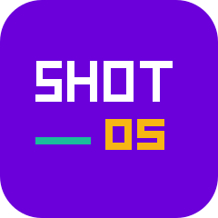
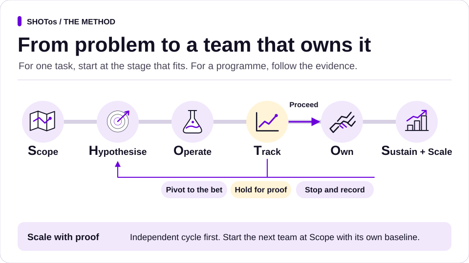

# SHOTos



**Free, open-source skills for the work you do with AI.**

SHOTos gives founders and teams reusable AI skills for work like proposals, leadership decisions and customer handoffs. Each skill helps you find the right inputs, check the result and give the next person enough context to continue.

**Try one job in your usual chat.** Copy the [one-message founder exercise](docs/guides/startup-founder.md#try-a-fictional-discovery-exercise), then compare the reply with the checks below it. To see what two connected skills produce, follow the [fictional proposal and handoff](packs/win-the-work/skills/contextual-proposal/worked-deal.md).

**Six-stage edition · 88 skills, 12 optional packs in this repository**

The [latest release](https://github.com/SHOTClubhouse/shotos/releases/latest) lists the skill ZIPs and source archive available for that version.

[Try it](#try-shotos) · [Choose a practice exercise](examples/README.md#practise-with-fictional-work) · [Find a skill](docs/what-you-can-do.md) · [Run the full pack](docs/full-pack.md)

## Pick your starting point

[Founder](docs/guides/start-by-role.md#founder) · [Commercial lead](docs/guides/start-by-role.md#commercial-lead) · [Product manager](docs/guides/start-by-role.md#product-manager) · [Graduate](docs/guides/start-by-role.md#graduate) · [Marketing manager](docs/guides/start-by-role.md#marketing-manager) · [Social content creator](docs/guides/start-by-role.md#social-content-creator)

**Founders.** [Choose a founder skill](docs/guides/startup-founder.md#try-one-task) for the problem, prospect or delivery handoff in front of you. [Try a fictional discovery brief](docs/guides/startup-founder.md#try-a-fictional-discovery-exercise) in one chat message.

**Enterprise leaders.** [Choose an enterprise skill](docs/guides/enterprise-operations.md#choose-the-work-in-front-of-you) for a decision, operating review, pilot or handoff. [Try a fictional leadership brief](docs/guides/enterprise-operations.md#try-a-decision-in-one-chat) using three short records.

Choose the role that fits the work in front of you. Try it on one real task and use the check to decide whether to keep it.

| I’m a… | Try this first | What would show it helped? |
| --- | --- | --- |
| **Business leader** | Use [Executive Decision Review](packs/exec-ops/skills/decision-brief/review-cycle.md#try-a-worked-scenario) to turn a recurring choice into a brief, a recorded decision and a handoff. | The decider can choose an option or name the evidence they still need. |
| **Founder** | Turn customer notes into a [problem brief and a small test](docs/guides/start-by-role.md#founder). | You have a decision to make and a way to learn before building. |
| **Commercial lead** | Turn buyer notes into an [offer and customer handoff](docs/guides/start-by-role.md#commercial-lead). | Delivery can see the accepted terms and who owns the next action. |
| **Marketing manager** | Turn a B2B or direct-to-consumer brief into a [campaign page people can try](docs/guides/start-by-role.md#marketing-manager). | A reviewer can follow the main visitor action and trace the offer to approved copy. |
| **Social content creator** | Turn dates and available assets into [a week of ready-to-review posts](docs/guides/start-by-role.md#social-content-creator). | Each slot has a clear purpose, an asset and a named reviewer. |
| **Analyst** | Use the [evidence pack](skills/evidence-pack/README.md) to compare a pilot with its baseline. | A sponsor can see the sample, the result and the gaps before deciding. |
| **HR or people lead** | Use the [enablement plan](skills/enablement-plan/README.md) to turn an onboarding workflow into a practice run with a clear owner. | The person taking it on can complete the agreed steps independently and show the evidence. |
| **Graduate or junior team member** | Turn an assignment into [a clear brief and a result to review](docs/guides/start-by-role.md#graduate). | Your lead can open the work, see your sources and give specific feedback. |
| **Product manager, product owner or tech lead** | Turn a feature request into [examples the team can build and check](docs/guides/start-by-role.md#product-manager). | The team can agree on a first slice and how to check it. |

**The hypothesis.** If you start with a task from your own role, give the assistant the source and agree a check, you can judge the first result against your work. If the result helps, save the accepted example and reuse it on the next task.

[Download one skill and try its example](docs/running-it.md#choose-your-first-job). The guide gives you the file to use and a concrete check for the result.

See a [worked customer handoff](packs/customer-success/skills/success-handoff/README.md) or [follow a change across all six stages](docs/walkthrough.md).

## Make it your team

Start with the assistant you already use. Give it a role, a task and a check. As the work grows, give other people or supported agents their own responsibilities and have them hand over the saved result and evidence.

- **Bootstrap with one assistant.** Use the same assistant to qualify a lead, draft the proposal and check the claims. You own the decision to send.
- **Move faster on repeat work.** Give drafting and checking clear responsibilities, and reuse the accepted brief, templates and checks. Bring in a separate reviewer when the decision needs one.
- **Scale across business areas.** Set up sales, operations, product or engineering around their own records, owners and permissions. Reuse the working agreement and evidence checks. Add the next team once its receiving lead can run a full cycle independently.

A role sets the responsibility. An audience persona tells you who the work is for. A review lens brings a perspective such as customer, commercial or sceptic. You can use all three in one assistant or assign roles to separate agents where your runtime supports them. Your garage records the tools and runtimes the team can use and how they were verified. [Set up your team](docs/full-pack.md) · [Choose from your garage](docs/full-pack.md#choose-from-your-garage)

## Try SHOTos

For one quick result, pick a [first job](docs/running-it.md#choose-your-first-job). To see how a team carries the evidence forward, try the [enterprise workflow exercise](docs/guides/enterprise-operations.md#try-one-workflow).

Explore the [Northbank fictional club website](https://shotclubhouse.github.io/shotos/) and its [worked example](examples/northbank-club/README.md), from visitor brief to public release.

**Start without a terminal.** Try the fictional retail decision in [Codex or Claude Code](docs/guides/codex-claude-code.md#copy-one-skill-without-a-terminal) or [ChatGPT or Claude](docs/guides/chat-assistants.md). Draft a recommendation from the initial evidence, then introduce the decision and handoff records to see whether the assistant updates each status correctly.

**On work you already have.** Open the [acceptance card](templates/acceptance.md). Pick one task, name the person who can accept it and write down one check that should fail. Use this prompt in your usual assistant:

> Use this card for the task. Show me the saved result and what you checked. Leave anything you could not verify open for review.

**See how the work gets checked.** Open the [worked proposal and handoff](packs/win-the-work/skills/contextual-proposal/worked-deal.md) to see the input, finished drafts and the two acceptance decisions. The [local checker guide](docs/claims.md) has the detailed checks.



## The six stages

**Scope · Hypothesise · Operate · Track · Own · Sustain and Scale.** Start with the stage that fits the job in front of you. Bring the stages together when a team needs to take an initiative from its first brief to a repeatable way of working.

| Stage | What you do | What you hand forward |
|---|---|---|
| **Scope** | Agree the problem, boundaries and how you will measure today | A problem brief and baseline |
| **Hypothesise** | Choose a testable bet and agree what counts as success | A hypothesis, experiment plan and acceptance checks |
| **Operate** | Run a bounded pilot with the people who will use it | The actual result, checks and exceptions |
| **Track** | Compare the outcome with the baseline and make a decision | Evidence and a decision to proceed to Own, pivot, stop or hold |
| **Own** | Give the receiving team the access, runbook and practice to run a full cycle | Evidence the team ran independently and a named lead accepted it |
| **Sustain and Scale** | Maintain the original workflow and start the next team at Scope | A supported rollout, local baselines and a review cadence |

Use the [framework](docs/framework.md) for the stage guides and the [programme record](templates/programme.md) to link the evidence and decisions. An everyday task uses the relevant stage and skill. A programme follows the gates across all six.

## What it looks like

A property manager wants fewer tenants chasing repair updates. Scope counts repeat contacts. Hypothesise sets a target and agrees checks for accurate, private updates. Operate drafts a small batch and flags the case with a missing date. Track compares repeat contacts after an authorised live run. Own asks the operations team to complete a weekly cycle without its builders. Sustain and Scale gives the next office the runbook and asks it to establish its own baseline.

The [Harbourside walkthrough](docs/walkthrough.md) includes data for the draft pilot and labelled scenarios for the later decisions.

## The four rules inside every stage

1. **Stop at the boundaries.** Get authority for actions that send, spend, publish, deploy or affect others.
2. **Agree acceptance first.** Name the owner, expected result and checks.
3. **Read back the real result.** Open the output, run the check or inspect the relevant system.
4. **Claim only what you can show.** Link the evidence and label what still needs verification.

The local [claim-check tool](docs/claims.md) tests supported completion claims against project evidence. A person accepts the work. Runtime and connector settings enforce permissions. [Rules and controls](docs/controls.md) · [Security](SECURITY.md)

## Install

[Copy skills into Codex or Claude Code on Windows or Mac](docs/guides/codex-claude-code.md) · [Use ChatGPT or Claude without a terminal](docs/guides/chat-assistants.md)

Use Git and Python 3.9 or later. Clone SHOTos next to the project where you want to use it, then run the commands from your own project folder.

```sh
git clone https://github.com/SHOTClubhouse/shotos.git
```

From your project folder:

```sh
python ../shotos/install.py --runtime agents --scope project --pack win-the-work --pack customer-success --pack setup --dry-run
python ../shotos/install.py --runtime agents --scope project --pack win-the-work --pack customer-success --pack setup
```

Open a fresh session in that project and ask:

> Use the Scope stage to write a brief for reducing repeat repair enquiries. I have a rough estimate. Propose the first measurement and say who should own it or what you need to confirm the owner.

Add another pack with the same install command and the new `--pack` value. For a no-terminal start, download the individual ZIPs from [GitHub Releases](https://github.com/SHOTClubhouse/shotos/releases/latest).

For Claude Code, use `--runtime claude` and add `--with-hook` if you want the optional completion check. For Gemini CLI, Antigravity and shared local setups, use the [runtime guide](docs/running-it.md). In a workspace that accepts project instructions, copy the [working agreement](templates/AGENTS.md), the [programme record](templates/programme.md) and the skills you need. The same templates work in a shared document.

## Pick the work you want to do

| Work | Start with |
|---|---|
| Qualify an opportunity or write a proposal | [Win the work](packs/win-the-work/README.md) |
| Run the week or prepare an executive decision | [Executive operations](packs/exec-ops/README.md) |
| Recover onboarding or transfer an account | [Customer success](packs/customer-success/README.md) |
| Define what good looks like before building | [Agree acceptance](skills/agree-acceptance/README.md) |
| Give another team the work and its evidence | [Evidence handoff](skills/evidence-handoff/README.md) |
| Prove a team can run the workflow and prepare the next wave | [Enablement plan](skills/enablement-plan/README.md) and [rollout plan](skills/rollout-plan/README.md) |

Browse all 88 [skill guides and downloads](docs/skill-catalogue.md), or choose a [task to try](docs/what-you-can-do.md). The [documentation](docs/README.md), [templates](templates/) and [examples](examples/README.md) show how the pieces fit. Follow a [worked proposal into customer success](packs/win-the-work/skills/contextual-proposal/worked-deal.md).

## What you can use today

The six-stage guide, programme record and task templates work in a shared document or an assistant that can read them. On Windows, fresh Codex CLI and Claude Code projects opened the proposal and handoff skills, wrote the drafts and held the gates for unapproved action in a replay. Claude Code’s Stop hook also caught a deliberate false file claim. [Setup by runtime](docs/running-it.md)

Created by Liam McDowell. Code is [MIT](LICENSE). Skills, docs and templates are [CC BY 4.0](LICENSE-docs.md). [Provenance and attribution](PROVENANCE.md)
