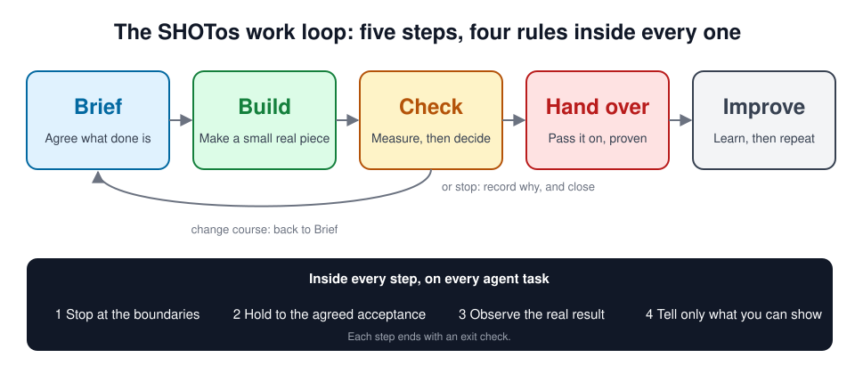

# The SHOTos work loop

SHOTos has two parts. The **four rules** apply to every task an agent does: Stop, Hold, Observe, Tell. The **work loop** is a plain five-step cycle for any piece of work, from one change to a team programme: **Brief, Build, Check, Hand over, Improve**. It is the familiar plan, do, check, act cycle, with a named output and an exit check at each step.



```
 Brief ──► Build ──► Check ──┬──► Hand over ──► Improve ──► next piece of work
 Agree what     Make the     Compare with     │   Pass it on      Learn, repeat
 done means     smallest     the baseline     ├── change course ──► back to Brief
                real piece                    └── stop ───────────► record why, and close

 Inside every step, on every agent task: Stop at the boundaries · Hold to the agreed acceptance
                                          Observe the real result · Tell only what you can show
```

Two things set the shape:

- **Every step has an exit check.** You do not move on because time has passed. You move on because the output exists and someone has accepted it.
- **Checking is a decision, not a ceremony.** After Check a named person chooses: hand it over, change course or stop. Stopping is a valid result.

The loop works for business change, technical change, or both at once. Each step below has a business side and a technical side, and most work has both. Use as much of it as the work deserves: a small change needs one sentence of expected result and one check, not five documents.

## Brief

Agree the problem, the people and what done means before building anything. Most wasted effort starts with a solution chosen before anyone wrote down the problem.

| | What you do |
|---|---|
| **Business** | Talk to the people who feel the problem and the people who decide. Map how the work flows today and where it waits, gets handed over or gets redone. Write down the situation, the problem and what it causes. Agree with the sponsor what is in scope and what is not. Write each idea as a testable bet: "We believe that X will result in Y, and we will know because Z changes" (the public Lean UX hypothesis form). Work through concrete examples with the people who will use the result. |
| **Technical** | Look at what exists: the systems, tools and data, how changes reach production today, how much is tested and what is fragile. Express the expected behaviour as examples (Given, When, Then) that become automated tests. Where output varies, as AI output does, build a set of example inputs with what a good answer must and must not contain, and keep it as the eval set. |
| **Agents help by** | Turning interview notes and messy requests into a problem statement, counting and categorising existing data, drafting examples and edge cases, proposing cases that should fail, and assembling the eval set from real examples. |

**Output:** a problem statement with no solution in it, a map of who is affected and who decides, baseline measures of how things are today (or "not measured", honestly), testable bets, an eval set and an acceptance card.

**Exit check:** the owner has confirmed the problem statement, every bet has a measure and a baseline, and the owner has agreed the acceptance checks.

**SHOTos assets:** [capture-the-problem](../skills/capture-the-problem/README.md), [stakeholder-map](../skills/stakeholder-map/README.md), [baseline](../skills/baseline/README.md), [maturity-check](../skills/maturity-check/README.md), [agree-acceptance](../skills/agree-acceptance/README.md), [hypothesis-card](../skills/hypothesis-card/README.md), [example-mapping](../skills/example-mapping/README.md), [eval-set](../skills/eval-set/README.md), [experiment-plan](../skills/experiment-plan/README.md), the [problem template](../templates/problem.md), the [acceptance card](../templates/acceptance.md) and [specification by example](../ways-of-working/specification-by-example.md).

## Build

Make the smallest real piece and put it into real use, working alongside the people who will own it.

| | What you do |
|---|---|
| **Business** | A small team delivers one real use case with the people who do the work today. Show progress regularly to the people affected, and report against the bet, not against activity. |
| **Technical** | Short cycles with automated build, test and deployment. Releases blocked by failing tests, and by failing evals where AI output is involved. Infrastructure described in code. Prove the riskiest part first. |
| **Agents help by** | Doing much of the building, testing and drafting, inside the four rules: stopping at the boundaries, working to the agreed acceptance, reading back the real result and claiming only what they can show. |

**Output:** a working result in real use and a written account of how it was done.

**Exit check:** the acceptance checks pass on the real result, and every claim of progress is backed by evidence.

**SHOTos assets:** [route-the-work](../skills/route-the-work/README.md), [pilot-before-scale](../skills/pilot-before-scale/README.md), [cross-agent-review](../skills/cross-agent-review/README.md), [research-and-assemble](../skills/research-and-assemble/README.md), [label-the-proof](../skills/label-the-proof/README.md), [report-with-evidence](../skills/report-with-evidence/README.md), [claim-check](claims.md), the Claude Code Stop hook and the [role agents](../agents/README.md).

## Check

Measure what changed against the baseline, then decide.

| | What you do |
|---|---|
| **Business** | Compare before and after against the baseline in the brief. Write a short report of the value actually realised, and hold a retrospective on how the work went. |
| **Technical** | For software delivery, track the four DORA measures: deployment frequency, lead time for changes, change failure rate and time to restore. Add eval scores, cost and response times for AI features, defects found after release, and monitoring of the live system. |
| **Agents help by** | Gathering the numbers, comparing them with the baseline and drafting the report, with every figure sourced. |

**Output:** an evidence pack and a recorded decision: hand over, change course or stop.

**Exit check:** the decision is made by a named person, on the evidence, and written down. A change of course goes back to Brief.

**SHOTos assets:** [evidence-pack](../skills/evidence-pack/README.md), [delivery-metrics](../skills/delivery-metrics/README.md), [decision-record](../skills/decision-record/README.md), [progress-wrap-up](../skills/progress-wrap-up/README.md), [retrospective](../skills/retrospective/README.md), and claim-check for agent work.

## Hand over

Pass the result to the people who will run it, with enough evidence and practice that they can.

| | What you do |
|---|---|
| **Business** | Train the people who will run it. Write down how the work is now done, and name who can do what. |
| **Technical** | Pair with the team until they can make changes and release on their own. Hand over runbooks, templates and the standard way to do common tasks. |
| **Agents help by** | Drafting runbooks and guides from what was actually done, and handing work over with its state and evidence intact. |

**Output:** a runbook, a capability matrix showing who can do what, and a handoff that says what is known, from where and what is not.

**Exit check:** the team has run at least one full cycle, including a release or a reporting period, without the people who built it.

**SHOTos assets:** [evidence-handoff](../skills/evidence-handoff/README.md), [runbook](../skills/runbook/README.md), [enablement-plan](../skills/enablement-plan/README.md), [resume-pack](../skills/resume-pack/README.md) and the [handoff template](../templates/handoff.md).

## Improve

Keep what works, change what does not, and take the method to the next piece of work.

| | What you do |
|---|---|
| **Business** | Look at what the last piece taught you and change the way of working. Where a result is worth repeating elsewhere, plan the rollout one small group at a time. |
| **Technical** | Turn what worked into reusable templates and shared platforms. Review prompts, skills and checks the way you review code. |
| **Agents help by** | Applying the same rules and templates in each new piece of work, and proposing improvements with the evidence for them. |

**Output:** a changed rule, template or skill with the evidence behind it, and, where it is worth repeating, a rollout plan.

**Exit check:** the next piece of work starts at Brief with its own baseline. Repeating copies the method, not the assumptions.

**SHOTos assets:** [learning-loop](../skills/learning-loop/README.md), [rollout-plan](../skills/rollout-plan/README.md), [skill-quality-gate](../skills/skill-quality-gate/README.md), [graduation-ladder](../skills/graduation-ladder/README.md) and the [setup pack](../packs/setup/README.md).

## Three illustrative examples

These are made-up examples to show the shape of each step. The numbers are bets a team might set, not results anyone has achieved.

### Business: an insurer trials AI triage of claims

| Step | What happens |
|---|---|
| Brief | Claims take nine days on average. Mapping the flow shows where claims wait. The bet: "AI triage of low-risk claims will cut handling time by 30% with no rise in errors." Fifty past claims, with the decisions people made, become the eval set. |
| Build | A small team delivers triage for one claim type in eight weeks, showing progress to the claims director every fortnight. |
| Check | Handling time, agreement with human decisions and cost per claim, against the baseline. The director decides. |
| Hand over | Claims handlers learn to review the AI's calls, and the in-house team runs the evals itself. |
| Improve | The approach moves to the next claim type, with one experienced person joining each new team. |

### Technical: a retailer moves to continuous delivery

| Step | What happens |
|---|---|
| Brief | Releases are monthly, much of the testing is manual and releases are often rolled back. The bet: "Automated regression tests on checkout will let us release weekly with fewer incidents." |
| Build | The checkout team gets a pipeline first, with automated tests and feature flags. |
| Check | The four DORA measures, before and after. |
| Hand over | Engineers from outside the team pair with the checkout team until they run the pipeline themselves, then hand over runbooks. |
| Improve | The pipeline becomes a template for the other teams. |

### Community: a grassroots sports club

| Step | What happens |
|---|---|
| Brief | Volunteer coaches have no shared session structure, and many players stop playing around age 13. The club records attendance and a simple skills check as its baseline. The bet: structured sessions improve skills scores by 10% over twelve weeks. |
| Build | One age group runs the structured sessions for a term. |
| Check | Re-test the skills check and compare attendance and retention with the baseline. |
| Hand over | The volunteer coaches run the sessions themselves. |
| Improve | The other age groups adopt what worked. |

For a full worked example you can run with an agent, follow the [walkthrough](walkthrough.md). It takes a fictional lettings company through Brief, Build and Hand over in about 20 minutes.

## Where the loop comes from

The loop draws on public practice: plan, do, check, act; build, measure and learn from lean product development; specification by example and behaviour-driven development; the DORA research on software delivery; product thinking over project thinking; and Team Topologies on how teams own their work. What SHOTos adds is an exit check at each step and the four rules that keep agent work honest inside every step. Sources are listed in [sources.md](sources.md).
