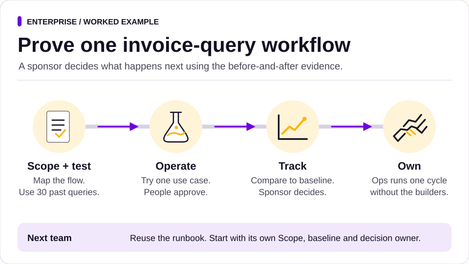

# Start here: a COO or operations leader in a large organisation

You run operations for a large business: thousands of staff, many sites, a technology function, a risk function and a board. Teams are already using AI tools, some approved and some not. You want the productivity without losing control of what goes out, what gets spent and what gets claimed.

## Try one workflow

Start with one team, one recurring task and the people who own it. Use an approved assistant and source set. A supplier invoice query is a good starting point when an operations lead can name the current queue, approved response policy and escalation path.

| Role | First job | What they leave in the same work record |
| --- | --- | --- |
| Process owner | Choose one query type and name who can review and approve it | Scope, allowed data and actions, and the existing response baseline |
| Operator | Use the approved sources to prepare drafts for review | Draft responses, policy citations and cases that need escalation |
| Reviewer | Check a routine draft and an exception against the agreed criteria | What passed, what needed rework and what still needs a decision |
| Sponsor | Decide what the evidence supports | A dated decision to continue, change, hold or stop |
| Receiving lead | Run the next cycle once ownership is agreed | Evidence they could run it and their acceptance |

Start with the [work record](../../templates/work-record.md) and [acceptance card](../../templates/acceptance.md). Use the prompt below with approved or fictional sample inputs.

> Prepare a draft answer for each supplier query using the attached policy. Cite the source for any commitment. Route disputed charges to the finance owner and show who should pick up each exception. Keep replies as drafts and record what the reviewer needs to decide.

To try it without supplier data, use the [fictional invoice-query exercise](invoice-query-exercise.md). Four separate input files take the same queue from the first draft and exceptions through sponsor review, independent ownership and a conditional rollout. The reviewer keeps the answer key separately.

Use [Evidence Pack](../../skills/evidence-pack/README.md) for the pilot review and [Enablement Plan](../../skills/enablement-plan/README.md) when the receiving lead is ready to take over.

For a pilot spanning two organisations, use the [partner pilot workflow](partner-pilot.md) to record commercial scope, launch approval, communications approval and ownership in the same programme record.

For a batch of account or membership changes, use [Reconcile Records Before a Batch Change](../../packs/records/skills/reconcile-before-batch-change/README.md) to give operations, the data owner and the operator one plan to review.

For a risk review, use [Review one AI-assisted workflow](enterprise-risk-review.md) to bring the scope, acceptance evidence, ownership and stop conditions into your existing decision record.

## What SHOTos gives you

- **One way of working that business and technical teams share.** The six stages ([framework](../framework.md)) work for a process change in stores, a new system in head office, or both at once.
- **Controls a risk function can read.** The [twelve agent controls](../../rules/README.md) and six [guardrails](../../rules/guardrails/README.md) state who decides, what agents may do alone and what evidence each piece of work leaves behind.
- **Evidence instead of anecdotes.** Every agent task ends with claims a tool can check. Track produces an evidence pack against a baseline, so a pilot ends with a decision to move to Own, pivot, stop or hold for evidence rather than a slide saying it went well.
- **Ownership before scale.** The Own stage makes the team that runs a result self-sufficient before it is copied to the next region or function.

## A first 90 days

| Weeks | Stage | What happens | SHOTos assets |
|---|---|---|---|
| 1 to 2 | Scope | Pick one value stream with a visible pain, for example supplier invoice queries. Map the flow, record today's numbers, name the owner. | [capture-the-problem](../../skills/capture-the-problem/README.md), [stakeholder-map](../../skills/stakeholder-map/README.md), [baseline](../../skills/baseline/README.md) |
| 3 | Hypothesise | Write two or three bets with measures. Build an eval set from 30 real past queries with the answers people gave. | [hypothesis-card](../../skills/hypothesis-card/README.md), [eval-set](../../skills/eval-set/README.md) |
| 4 to 9 | Operate | A small team delivers one use case in real use, with agents drafting and people approving. Fortnightly show-and-tell to the sponsor. | [agree-acceptance](../../skills/agree-acceptance/README.md), [route-the-work](../../skills/route-the-work/README.md), [pilot-before-scale](../../skills/pilot-before-scale/README.md) |
| 10 | Track | Before and after against the baseline. The sponsor records a decision. | [evidence-pack](../../skills/evidence-pack/README.md), [decision-record](../../skills/decision-record/README.md) |
| 11 to 13 | Own | The operations team runs it without the builders for one full cycle. | [runbook](../../skills/runbook/README.md), [enablement-plan](../../skills/enablement-plan/README.md) |

Then [Sustain and Scale](../../skills/rollout-plan/README.md): the next team starts at Scope with its own baseline.

## What to give each part of your organisation

| Who | Give them | Why |
|---|---|---|
| Executive assistants and chiefs of staff | The [exec-ops pack](../../packs/exec-ops/README.md) | A daily brief, inbox triage and decision briefs, all drafts until a person approves |
| Commercial and buying teams | The [win-the-work pack](../../packs/win-the-work/README.md) | Proposals with every claim sourced; qualification with NUDGE |
| Marketing and communications | The [content](../../packs/content/README.md), [social](../../packs/social/README.md) and [trust](../../packs/trust/README.md) packs | Drafts to an agreed brief, a claims audit before anything goes public |
| Technology | The [ways of working](../../ways-of-working/README.md), the role [agents](../../agents/README.md), claim-check in CI | Specification by example, DORA measures, evidence before merge |
| Risk, legal and data protection | The [guardrails](../../rules/guardrails/README.md) and the [trust pack](../../packs/trust/README.md) | Data classification, exposure checks and an approved purpose, source set and access scope |

## What it does not do

- It does not replace your AI policy, your security review or your procurement process. It gives them something concrete to review.
- It does not enforce boundaries inside third-party tools. Rule 1 is followed by the agent and checked by people; claim-check tests claims after the fact.
- The published evidence so far is limited. Read [what we can prove](../evidence.md) and run your own paired tests on your own work before relying on it.
