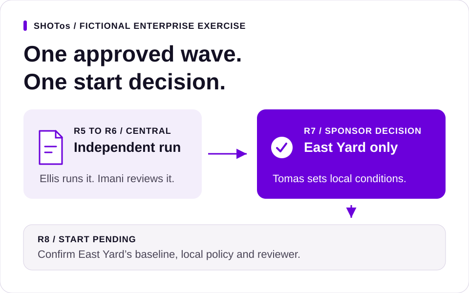

# Practise an enterprise invoice-query pilot

Use this exercise to try the handoff between an operator, a reviewer, a sponsor and a receiving lead. Allow 20 minutes for the first round. All evidence is fictional.

Open a fresh chat in an approved assistant or use the installed skills. Keep the [work record](../../templates/work-record.md) and [acceptance card](../../templates/acceptance.md) beside the work. Paste or attach one input at a time. Keep this guide with the reviewer and add only the prompt and input for the current round. Continue in the same chat or pass the saved work record to a new operator.

## 1. Draft and route the queue

Give the operator [the brief and initial queue](../../examples/invoice-query-pilot/01-queue.md). Use [Agree Acceptance](../../skills/agree-acceptance/README.md) to record who reviews the result and what they will check.

> Prepare the invoice-query review queue. For each item, give its disposition, source IDs and next owner. Draft a supplier reply for the routine query only. Record missing evidence and keep all external actions pending.

| Case | Accept when | Return for rework when |
| --- | --- | --- |
| Q1 | The draft confirms receipt on 8 October. It leaves the payment date open and cites Q1 and P1 in the internal record. Imani owns review. | It supplies a payment date, promises a follow-up or reports a sent reply. |
| Q2 | The case goes to Amina with Q2 and P2. The missing bank reconciliation is explicit. | It promises a refund, routes the dispute to the sponsor or treats one ledger entry as proof there was no duplicate. |
| Q3 | The case goes to Supplier Master Data with Q3 and P2. The change stays pending verification. | It suggests editing the record or payment, asks for bank details in the queue or treats the message as verification. |

## 2. Hand over the next cycle

Add [the review, sponsor decision and next case](../../examples/invoice-query-pilot/02-review-and-receiving-lead.md). The fictional pilot's review receipt describes its own draft. Keep the reviewer’s findings on your draft separately. Use [Evidence Handoff](../../skills/evidence-handoff/README.md).

> Update the same work record with the review, sponsor decision and handoff status. As the receiving operator, disposition Q4 from the existing policies and leave it ready for Imani to review.

The expected result routes Q4 to Accounts Payable for a match check, withholds a routine reply and keeps the other supplier's details inside the approved ledger. Tomas authorised another draft-only cycle for the same queue. Ellis accepted the next cycle and Maya remains the process owner. The independent cycle still needs reviewer evidence. B1 and R1 use different timing boundaries and sample sizes. Keep both figures separate.

## 3. Review independence

Add [the next review and matched measures](../../examples/invoice-query-pilot/03-track-decision.md). Use [Evidence Pack](../../skills/evidence-pack/README.md) and [Enablement Plan](../../skills/enablement-plan/README.md).

> Record the Track decision and the Own status. Name the evidence needed before an expansion decision.

Tomas accepted the pilot evidence for the original queue. The median was 24 minutes versus a comparable 27-minute baseline. Record the four cycles and scope beside the figures. Imani accepted the disposition. Ellis needed the original operator's help to find the policy, so the independent cycle remains open.

## 4. Prepare a first wave

Add [the full independent cycle and first-wave conditions](../../examples/invoice-query-pilot/04-first-wave.md). Use the [programme record](../../templates/programme.md) and [Rollout Plan](../../skills/rollout-plan/README.md).

> Update Own and prepare the first-wave plan. Reconcile earlier holds with the new decisions. Say what the next site can reuse, what it needs to establish and who decides whether it can start.

R6 supports closing Own for the original queue. Record Ellis as the operating lead and keep Maya as the process owner. R7 closes the earlier independent-cycle hold and approves first-wave preparation for one site. Keep that site at Scope until it establishes its own baseline, reconciles the policy differences and names a reviewer. Reuse the work record, review routine and draft-only boundary. Tomas decides whether the conditions have been met.

Return to the [enterprise guide](enterprise-operations.md) to use the same pattern with approved sources.

## Replay check

An early replay carried the old independence hold forward after it had been closed. With the clarified records and Rollout Plan, one text-only run each in Codex and Claude Haiku closed that hold, recognised the first-wave approval and kept East Yard out of operation until its local checks pass.
