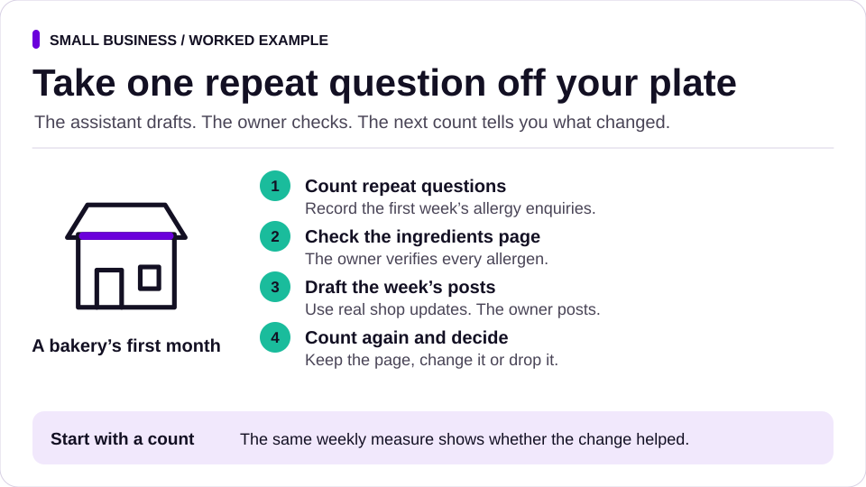

# Start here: a small business owner

You run a bakery, a salon, a garage, a shop or a café. You have a handful of staff and no IT department. You have used a chat assistant for the odd email or menu, and you would like it to take some of the admin off you without it saying something wrong to a customer or spending money you did not agree.

You do not need to know anything about software to use SHOTos. Most of it works as plain templates on paper, and the agent skills work in any assistant that can read a folder of instructions.

## Getting set up (about 15 minutes)

Pick the route that suits you. You do not need both.

**Route 1: the Claude app, no terminal.**
1. Install the Claude desktop app, or use claude.ai in your browser, and sign in.
2. Download individual skill ZIPs from [GitHub Releases](https://github.com/SHOTClubhouse/shotos/releases/latest). Start with `agree-acceptance`, `capture-the-problem`, `report-with-evidence` and the [social](../../packs/social/README.md) and [writing](../../packs/writing/README.md) skills.
3. Upload each ZIP as a skill using the [Claude steps](chat-assistants.md#claude-with-skills-enabled). If skills are not available in your workspace, attach the files to a chat instead.
4. Create a Project for your business. Paste the four rules from the [working agreement](../../templates/AGENTS.md) into the Project's instructions, and add your price list and recipe cards as Project files.
5. Connect Google Drive or Gmail from the app's connector settings only if you want the assistant to read them. Read-only is enough to start.

**Route 2: Claude Code, if someone can help you install it once.**
1. Install Claude Code (the VS Code extension or the desktop app).
2. Make a folder for your business admin and open it. Download and extract the source archive from the [latest release](https://github.com/SHOTClubhouse/shotos/releases/latest) next to it. That extracted folder is your local checkout.
3. Ask the assistant: "Use the SHOTos installer in my local checkout. Preview a project install with the social, writing, records, trust and setup packs, and show me what it will change first."
4. Ask it to run [connect-tools](../../packs/setup/skills/connect-tools/README.md), which lists what works today and what to connect next.

Either way, your first request can be as simple as: "Before you start, agree with me what good looks like for our Christmas order form."

## The three habits that matter most

1. **Say what good looks like before you ask.** "Write the Christmas order form" becomes: "Write the Christmas order form. It must list our six Christmas lines with this year's prices, the last order date of 18 December, and the collection times. It must not promise delivery, because we do not deliver." That is an [acceptance card](../../templates/acceptance.md) in two sentences.
2. **Nothing goes out without you.** The assistant drafts; you send. It is told never to order stock, post on your page, email a customer or delete anything until you say yes. This is [rule 1](../controls.md). For a hard stop, do not give it tools that can do those things on their own.
3. **Ask it what it checked.** At the end, the assistant lists what it did and what it could not check. If it says "prices match the price list", you can look.

## A first month

| Week | What to try | Skill or template |
|---|---|---|
| 1 | Write down one thing that eats your time, for example answering the same allergy questions by phone and message. Count how many you get in a week. | [problem template](../../templates/problem.md), [baseline](../../skills/baseline/README.md) |
| 2 | Have the assistant draft an allergy and ingredients page from your recipe cards. Check every allergen yourself before it goes anywhere. | [agree-acceptance](../../skills/agree-acceptance/README.md), [claims-audit](../../packs/trust/skills/claims-audit/README.md) |
| 3 | Plan a week of social posts from what is actually happening in the shop, drafted for you to post. | [content-calendar](../../packs/social/skills/content-calendar/README.md), [caption-options](../../packs/social/skills/caption-options/README.md) |
| 4 | Count the allergy questions again. Did the page help? Keep it, change it or drop it. | [evidence-pack](../../skills/evidence-pack/README.md) |

## Useful packs for a small business

- [Social](../../packs/social/README.md): a weekly plan, captions and reviewing comments, with you posting.
- [Writing](../../packs/writing/README.md): turn rough notes into clear customer messages.
- [Records](../../packs/records/README.md): sort out the folder of invoices, photos and recipes without losing anything.
- [Founder admin](../../packs/founder-admin/README.md): find grants and local business awards you can enter for free.
- [Trust](../../packs/trust/README.md): check claims before they go on your website, and handle customer and children's data carefully.

## Be careful with

- **Allergens, prices and opening times.** Always check these yourself. An assistant can copy a wrong number confidently.
- **Photos of customers, especially children.** Get written permission first. The [sensitive-data-check](../../packs/trust/skills/sensitive-data-check/README.md) skill walks through it.
- **Anything that costs money.** Supplier orders, ads and subscriptions are always your decision.
