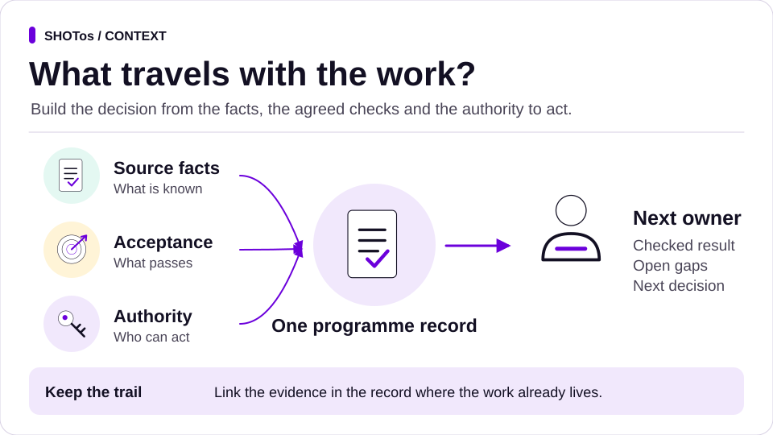
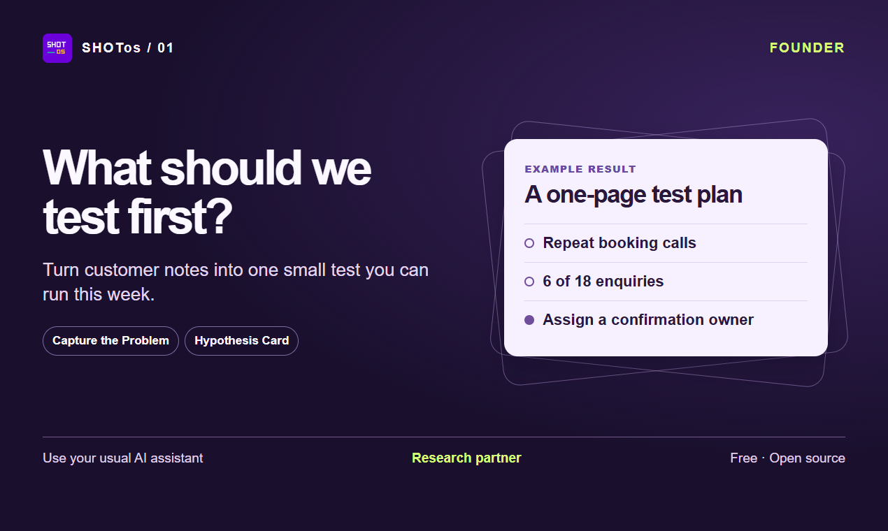
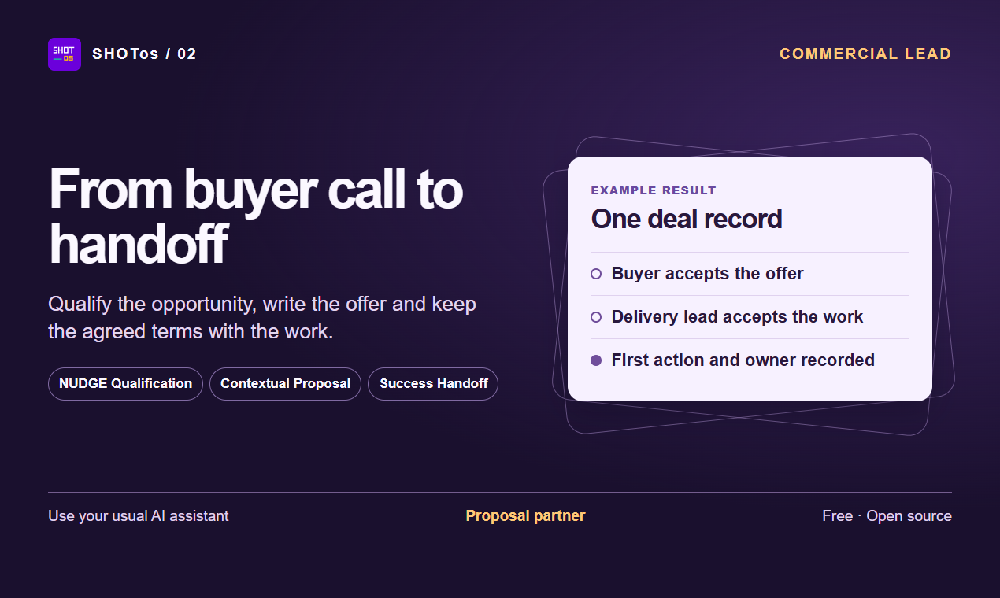
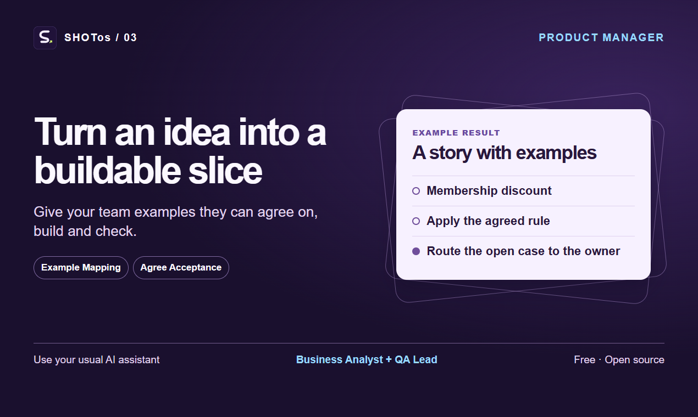
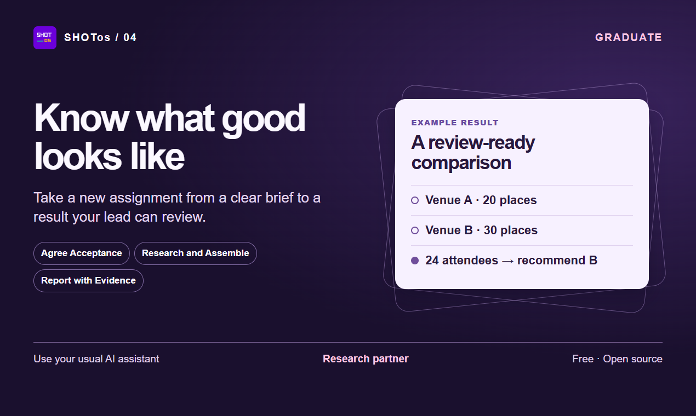
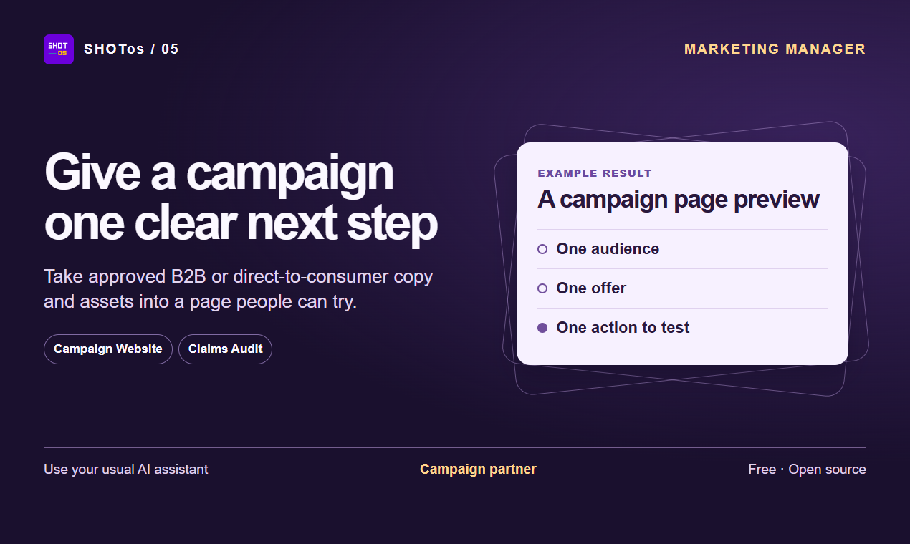
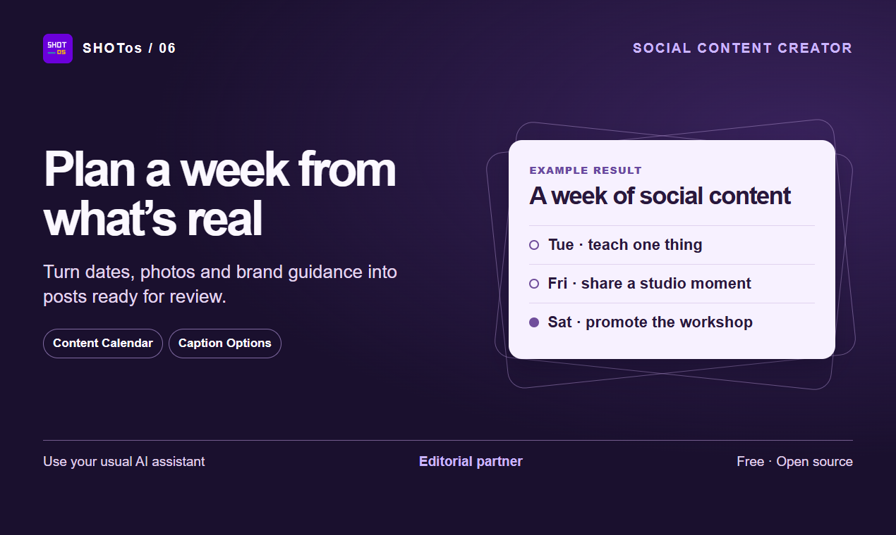
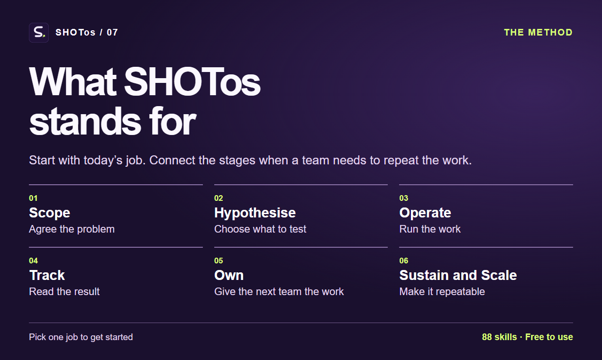

# Start with the work you do

[See what the six stages give you](../framework.md#try-one-job-across-the-six-stages), then choose one job to try.

Try SHOTos for free in the AI assistant you already use. Pick one job, give the assistant the relevant sources and check the result against the example. Each route names a small, testable bet. Keep it as the check for your own version of the job.

Every route works without a terminal. Try the fictional example in one chat, or download that route's skill ZIP and [add it to ChatGPT or Claude](chat-assistants.md) or [copy it into Codex or Claude Code](codex-claude-code.md#copy-one-skill-without-a-terminal). Use the [installer](../../README.md#install) when you want a whole pack in a project.

[Business leader](#business-leader) · [Founder](#founder) · [Commercial lead](#commercial-lead) · [Product manager](#product-manager) · [Graduate](#graduate) · [Marketing manager](#marketing-manager) · [Social content creator](#social-content-creator)

## Business leader

**Job.** Turn a recurring choice into a brief the decider can act on, then record the decision and who runs the next review.

- **Start with** a few dated records and the name of the person who decides. [Decision Brief](../../packs/exec-ops/skills/decision-brief/README.md) gives a recommendation, a credible alternative and the evidence that would change it.
- **Bet.** A one-page brief that cites its records lets the decider choose an option or name the evidence still needed in one review.
- **Keep** the brief, the recorded decision and the handoff against the same record. Give the assistant an analyst role and keep the decision with the named leader.

[Try the fictional retail decision in one chat](enterprise-operations.md#try-a-decision-in-one-chat) · [Download `decision-brief.zip`](https://github.com/SHOTClubhouse/shotos/releases/latest/download/decision-brief.zip)

## Founder

**Job.** Decide what to test before committing to a build.

- **Start with** customer notes and the idea someone has proposed. [Capture the Problem](../../skills/capture-the-problem/README.md) separates the observations from the proposed solution.
- **Use next** [Hypothesis Card](../../skills/hypothesis-card/README.md) to make a small, testable bet with a measure and a decision owner.
- **Bet.** Assigning one person to confirm bookings for a week cuts repeat calls before anyone builds an app.
- **Keep** the problem brief, its sources and the test plan. Give the assistant a research role and keep the decision with the founder.

[Try the fictional repair-workshop exercise in one message](startup-founder.md#try-a-fictional-discovery-exercise) · [Download `capture-the-problem.zip`](https://github.com/SHOTClubhouse/shotos/releases/latest/download/capture-the-problem.zip)

## Commercial lead

**Job.** Move a buyer conversation into a proposal and give delivery the context to take it on.

- **Start with** buyer notes, the approved offer and the account record. [NUDGE Qualification](../../packs/win-the-work/skills/nudge-qualify/README.md) helps decide whether to progress the opportunity.
- **Use next** [Contextual Proposal](../../packs/win-the-work/skills/contextual-proposal/README.md) to draft the offer. Once the buyer accepts, [Success Handoff](../../packs/customer-success/skills/success-handoff/README.md) carries the accepted version and open actions forward.
- **Bet.** Carrying one account record from proposal to handoff lets delivery take the first action without asking the seller for missing context.
- **Keep** one account record with the buyer's acceptance, the named receiving lead and their first action. Give the assistant a proposal role, then a handoff role when delivery takes over.

[Follow the fictional North Quay deal from proposal to handoff](../../packs/win-the-work/skills/contextual-proposal/worked-deal.md) · [Download `contextual-proposal.zip`](https://github.com/SHOTClubhouse/shotos/releases/latest/download/contextual-proposal.zip)

## Product manager

**Job.** Give your team a small buildable slice with examples everyone can agree on. Product owners and tech leads use the same route.

- **Start with** a feature request and the business rules you know. [Example Mapping](../../skills/example-mapping/README.md) gives you concrete examples and questions for the product owner.
- **Use next** [Agree Acceptance](../../skills/agree-acceptance/README.md) to record what the team will check before calling the work done.
- **Bet.** Worked totals for two or three real families show which discount rule the committee meant before anyone changes the form.
- **Keep** the agreed examples with the story. Use the [Business Analyst role](../../agents/business-analyst.md) to frame the work and the [QA Lead role](../../agents/qa-lead.md) to check the result.

**Try it.** Paste the [fictional membership-discount request](../../examples/example-mapping/input.md) into a fresh chat and ask for an example map with the open questions and who answers them. A useful map shows that the treasurer's and registrar's readings give different totals for the same family and leaves the rule with the committee. Compare yours with the [worked output](../../examples/example-mapping/output.md). [Download `example-mapping.zip`](https://github.com/SHOTClubhouse/shotos/releases/latest/download/example-mapping.zip)

## Graduate

**Job.** Take an unfamiliar assignment from a short brief to a result you can show your lead.

- **Start with** the assignment and the sources your lead gives you. [Agree Acceptance](../../skills/agree-acceptance/README.md) helps you agree what to produce and who will review it.
- **Use next** [Research and Assemble](../../skills/research-and-assemble/README.md) to organise source material. [Report with Evidence](../../skills/report-with-evidence/README.md) helps you point the reviewer to the result and the checks you completed.
- **Bet.** A short result that cites its sources and names its open question gets specific feedback from your lead in one review.
- **Keep** the brief, source links and the result in the team’s agreed location. Ask the assistant to act as a research partner while you and your lead agree the scope.

**Try it.** Your lead wants a one-page venue comparison. Venue A costs £80 for an evening and has space for 20. Venue B costs £100 and has space for 30. You expect 24 people. Ask for a two-row comparison, a recommendation and one question about access. A useful draft recommends B on capacity, cites both quotes and names who will confirm access. Your lead decides whether to book. [Download `agree-acceptance.zip`](https://github.com/SHOTClubhouse/shotos/releases/latest/download/agree-acceptance.zip)

## Marketing manager

**Job.** Turn a B2B or direct-to-consumer campaign brief into a page with one clear next step.

- **Start with** the audience, offer, approved copy and assets. [Campaign Website](../../packs/content/skills/campaign-website/README.md) produces an editable page preview.
- **Use next** [Claims Audit](../../packs/trust/skills/claims-audit/README.md) to link the offer and product claims to their approved sources.
- **Bet.** A reviewer who has not read the brief can find and use the page's one main action on the first try, and every claim on the page traces to approved copy.
- **Keep** the preview, the intended visitor action and the page owner’s approval. Give the assistant a campaign role and review the main action as a visitor.

[Open the fictional campaign preview and try its main action](../../packs/content/skills/campaign-website/README.md) · [Download `campaign-website.zip`](https://github.com/SHOTClubhouse/shotos/releases/latest/download/campaign-website.zip)

## Social content creator

**Job.** Build a week of posts from the moments and material you actually have.

- **Start with** real dates, the photo and video library, brand guidance and the mix you want. [Content Calendar](../../packs/social/skills/content-calendar/README.md) maps the slots to assets and owners.
- **Use next** [Caption Options](../../packs/social/skills/caption-options/README.md) to turn a chosen slot into platform-ready drafts.
- **Bet.** A week planned only from real dates and assets you already hold fits your capacity, and every slot uses an asset you have permission to post.
- **Keep** the calendar, captions, source links and approval status. Give the assistant an editorial role and have the named reviewer check the batch.

[Try the fictional Tidewell Pottery brief](../../packs/social/skills/content-calendar/README.md#how-to-use-it) · [Download `content-calendar.zip`](https://github.com/SHOTClubhouse/shotos/releases/latest/download/content-calendar.zip)

## What SHOTos stands for

**Scope · Hypothesise · Operate · Track · Own · Sustain and Scale.** SHOTos is an operating system for taking a piece of work from a clear problem to a result someone can own and repeat. Use the stage that matches today’s job. [See how the six stages fit together](../framework.md).

[Find more roles](../personas.md) · [Choose your setup](../running-it.md) · [Download a skill](https://github.com/SHOTClubhouse/shotos/releases/latest)
