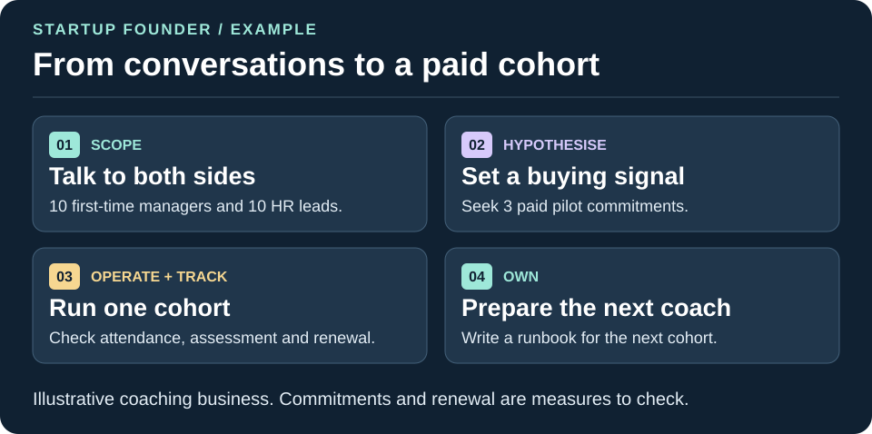

# Start here: a startup founder

Start with one question you need answered or one piece of work you can review today. If you are just exploring SHOTos, [try the fictional discovery brief](#try-a-fictional-discovery-exercise) in your usual assistant. It needs one message and no setup.

## Try one task

Pick the row whose input you have. Start with one skill, one source set and one result you can check. The [founder downloads](../running-it.md#founder-starting-points) give you one ZIP per job and a check for its sample.

| What you have | Start with | First result to check |
| --- | --- | --- |
| Customer notes and a proposed feature | [Capture the Problem](../../skills/capture-the-problem/README.md) | A one-page problem brief that separates what customers reported from the proposed fix. |
| A promising conversation with budget or buying authority still unclear | [NUDGE Qualification](../../packs/win-the-work/skills/nudge-qualify/README.md) | A go, pause or walk-away recommendation with one question for a named person. |
| A named buyer, their brief and an approved offer | [Contextual Proposal](../../packs/win-the-work/skills/contextual-proposal/README.md) | A buyer-facing draft and a private evidence sheet. Check approved terms against the source. |
| A signed or otherwise evidenced agreement ready for delivery | [Success Handoff](../../packs/customer-success/skills/success-handoff/README.md) | A record with the accepted revision, the first action and the receiving lead's status. |
| A proposed joint trial and a named partner | [Partner pilot](partner-pilot.md) | A launch recommendation with named owners, a measure and any permissions still pending. |
| A defined audience and a short list of things visitors need to do | [Build a Small Website](../../packs/content/skills/build-small-website/README.md) | A preview with the main visitor journeys checked on a narrow and wide screen. |

For a proposal, use [Bid Response](../../packs/win-the-work/skills/bid-response/README.md) when the buyer has issued a tender with required questions, evidence or submission rules.

For a proposal, start a fresh chat with the buyer's brief, the approved offer and any source you want the assistant to use.

> Draft a tailored proposal from these sources. Use the organisation template that fits the buyer. Save the draft and private working sheet separately. Show which claims are ready for my review, what still needs a decision and where the record should live. Leave dispatch with me.

Review the proposed terms and evidence together. If the buyer later accepts, pass the same record to the delivery lead and record their acceptance separately. Follow [one fictional deal](../../packs/win-the-work/skills/contextual-proposal/worked-deal.md) to see what travels.

If your assistant can only reply in chat, ask for the proposal copy and the private evidence sheet as separate sections. You can check the argument, terms and sources in that draft. Keep layout review open until you can render and inspect the proposal in the format the buyer will see.

## Try a fictional discovery exercise

Copy this whole block into a fresh chat. In a project with SHOTos installed, ask the assistant to use [Capture the Problem](../../skills/capture-the-problem/README.md) and [Hypothesis Card](../../skills/hypothesis-card/README.md).

~~~text
Draft a one-page problem brief for a fictional repair workshop and propose one small test. Separate the observed problem from the requested app. Cite D1–D4. Test assigning a confirmation owner while keeping the existing process and hours. Give the baseline, measure, proposed threshold, minimum comparable sample, stop condition and the person who decides whether to run it. Keep the test as a plan for review.

D1. The manager reports repeat calls about appointment availability and asks for an app.
D2. In one week, six of 18 phone enquiries led to at least one repeat confirmation call. There are no comparable weeks.
D3. Three of those six cases had a calendar slot but no staff member owned confirmation. The other three have no recorded cause.
D4. The manager can assign a front-desk owner for a one-week manual test. The founder can propose a change. The manager decides whether it runs.
~~~

Look for a plan that tests confirmation ownership before committing to software. An example bet is that assigning a confirmation owner for one week brings the repeat-contact rate down from the observed 6 of 18 to at most 1 in 6 comparable enquiries. Count each enquiry once, use the same recording window for both weeks and record missed bookings as a guard measure. The earlier tally gives no baseline for missed bookings. Compare only if the test records at least 18 comparable enquiries. Pause if a booking is missed because of the change. An inconclusive result goes back to the manager for review. A better result supports another bounded test, with software investment a separate decision.

### Read the result before deciding what to build

Try a second round with [Evidence Pack](../../skills/evidence-pack/README.md). Keep the original threshold and guard measure.

| ID | Follow-up record |
| --- | --- |
| D5 | The manager approved the manual test. In the agreed week, 3 of 18 phone enquiries led to a repeat confirmation contact. A new online form received six more enquiries, with no comparable online baseline. |
| D6 | The manager confirmed that a workshop slot was lost because the new confirmation owner was off shift and the backup had no access to the queue. |

> Compare the results with D2, check the guard and give the workshop manager one next decision. Explain what would need to change before another trial.

The phone measure reached 3 of 18, or one in six. The online enquiries belong in a separate line. The missed booking triggers the agreed pause, even though the primary threshold was reached. The manager can decide whether to fix backup access and approve another manual trial. The one-week result alone gives no decision to build an app.

## How SHOTos fits a startup

| You need to | SHOTos gives you |
|---|---|
| Win your first customers | The [win-the-work pack](../../packs/win-the-work/README.md): LEAP to run the pipeline, NUDGE to qualify each opportunity, proposals written for the reader with every claim sourced, outreach in small testable batches |
| Find out what people will pay for | [capture-the-problem](../../skills/capture-the-problem/README.md), [hypothesis-card](../../skills/hypothesis-card/README.md) and [experiment-plan](../../skills/experiment-plan/README.md): bets with measures before you build |
| Run the week without drowning | The [exec-ops pack](../../packs/exec-ops/README.md): one daily brief, inbox triage, meeting notes, decision briefs |
| Raise money or apply for grants | The [founder-admin pack](../../packs/founder-admin/README.md): grants, awards, investor updates from approved figures, a data room |
| Say only true things in public | The [trust pack](../../packs/trust/README.md): claims audit and exposure checks before anything goes live |
| Hand work to your first hire | [runbook](../../skills/runbook/README.md), [evidence-handoff](../../skills/evidence-handoff/README.md) and [resume-pack](../../skills/resume-pack/README.md) |

## Example: a new coaching business

A founder is launching a coaching business for first-time managers.

1. **Scope.** Ten conversations with first-time managers and ten with HR leads, captured as problem cards. The founder records the current paid-pilot conversion rate before recruiting the first cohort. If there are no comparable offers, the founder records that gap and uses the agreed three-of-ten threshold for the first decision.
2. **Hypothesise.** "First-time managers in companies of 50 to 500 staff will pay for a six-week group programme if their employer funds it, and we will know because three of the ten HR leads agree to a paid pilot." If two agree, run one more round of five conversations before deciding. If fewer than two agree, stop and go back to Scope.
3. **Win the work.** Each HR lead goes on the LEAP pipeline. NUDGE shows two of them have no budget owner: they are paused, not chased.
4. **Operate.** One pilot cohort. The agent drafts session notes and follow-ups; the founder sends.
5. **Track.** Attendance, a before and after self-assessment, and whether the employer renews. Decision recorded.
6. **Own.** The founder and second coach agree the runbook and access. The second coach independently runs a full cohort cycle and confirms the evidence as receiving lead. If there is no second coach yet, Own stays open.

## Agent habits worth adopting on day one

- Start with one relevant skill or install the [core](../../README.md#install). In Claude Code, the optional Stop hook can challenge an unchecked completion claim. In any tool, open the result and verify it against the agreed checks.
- Keep a `.work/` folder for drafts and notes ([work-folder](../../packs/records/skills/work-folder/README.md)).
- Use the [graduation ladder](../../rules/12-graduation.md) before letting any task run without you: earn autonomy with a record of accepted drafts.
