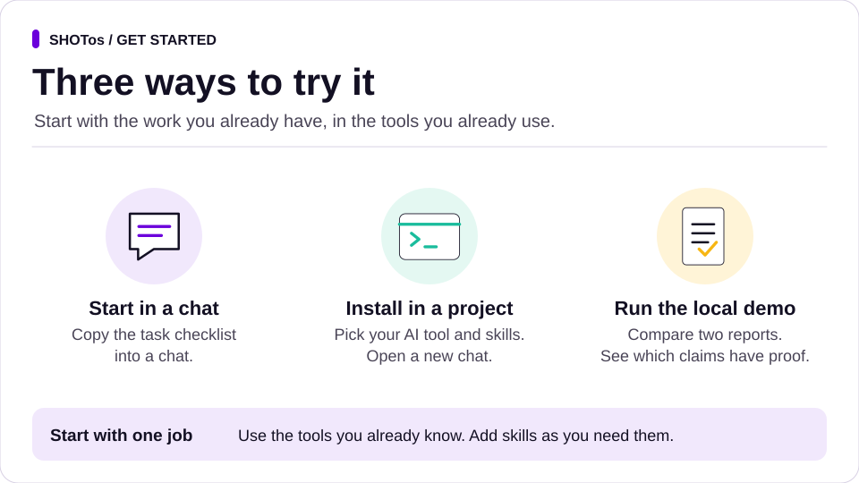

# Run SHOTos in your project

Start with the runtime your team already uses. [Try the method](../README.md#try-shotos) with an acceptance card or run the local demo. The [install guide](../README.md#install) shows how to preview what changes in your project.

| Runtime | Setup | What it gives you |
|---|---|---|
| **Claude Code** | `--runtime claude --scope project` | Skills and project rules. Add `--with-hook` for the Stop hook and `--with-agents` for role agents. |
| **Codex** | `--runtime codex --scope project` | Skills in `.codex/skills` and rules in `AGENTS.md`. Run claim-check from a terminal. |
| **Gemini CLI** | `--runtime gemini --scope project` | Skills in `.gemini/skills` and an import of `AGENTS.md` in `GEMINI.md`. Verify skill loading in your runtime before adoption. |
| **Antigravity** | `--runtime antigravity --scope project` | Skills in `.agents/skills` and an import of `AGENTS.md` in `GEMINI.md`. Verify skill loading in your runtime before adoption. |
| **Several local runtimes** | `--runtime all --scope project` | Shared project rules and skills in the relevant runtime folders. Review the install plan for each tool your team uses. |
| **Other compatible local agents** | `--runtime agents --scope project` | The shared `.agents/skills` directory and project rules. |
| **Claude app** | Package the skills from this checkout with `python tools/package_skills.py --pack <name>` and upload the ZIPs in a compatible setup. Add the [working agreement](../templates/AGENTS.md) to your Project instructions. | Skills and the six-stage working agreement. |
| **ChatGPT or another assistant** | Add the [project rules](../templates/AGENTS.md) and the relevant skill files to a project or assistant that can read them. | The workflow as instructions and templates. |
| **Manual** | Copy the [templates](../templates/) into the tools you already use. | Briefs, checklists, decision records and handovers. |

Pass these flags to `python /path/to/shotos/install.py` from the project you want to configure. Add `--pack <name>` once per pack, `--list-packs` to see the options and `--dry-run` to preview the plan. Use `--scope user` for a skills-only install where supported. Project installs include the programme record at `.shotos/templates/programme.md`. [Security and installer behaviour](../SECURITY.md)

## Use it with a chat assistant or manually

Keep the programme record where your team already works. Give the assistant the working agreement, the current record and the skill for the next decision. You can start with this instruction in any tool that can read the material you give it:

> Read the working agreement and programme record. Identify the current stage and its exit check. Link the evidence you can verify, name who makes the decision and leave any missing approval or measurement open. Continue the authorised work for this stage.

A document, spreadsheet, issue or CRM record can hold the programme. Use links to original evidence and keep access controls on the source.

## Team rollout

1. Preview a project install in an isolated checkout. If the project already has an `AGENTS.md`, integrate the working agreement into your existing instructions.
2. Pick one workflow and start at Scope. Name the sponsor and use the [programme record](../templates/programme.md) to capture the baseline and the next gate. In a fresh session, confirm the agent opens the expected stage skill.
3. Progress through Hypothesise, Operate and Track. Review the work where it lives and use claim-check for supported completion claims. Your runtime and connectors enforce access and action permissions.
4. Use Own to verify one independent cycle with the receiving team. In Sustain and Scale, agree a first wave, local baseline and stop conditions. [Stage guide](framework.md) · [Walkthrough](walkthrough.md)

The local installers and optional Claude Code hook provide the tooling for this edition. Validate skill loading, connector access and approval paths in your environment before rolling out live work. [Validation evidence](evidence.md) · [Connect your tools](connect-your-tools.md) · [Claim-check](claims.md)
