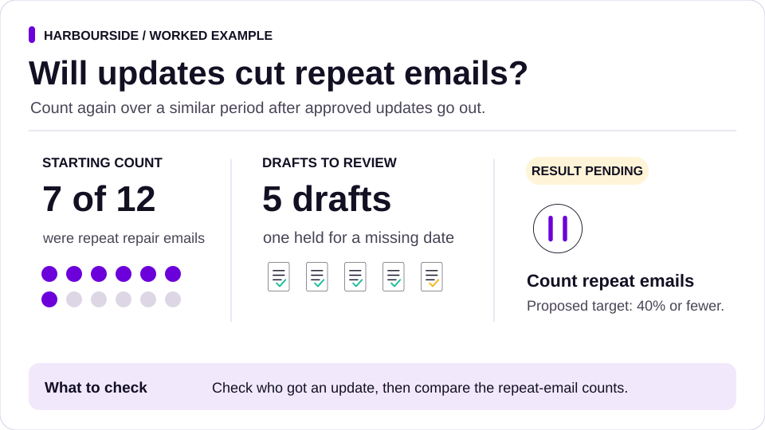

# Walkthrough: from "we need a chatbot" to a fix that works

Follow one initiative across the [six stages](framework.md) using Harbourside Lettings, a fictional property management firm. You can run the initial draft pilot with the supplied files. Track, Own and Sustain and Scale use labelled scenarios so you can practise the decisions that follow a pilot.

The [walkthrough files](../examples/walkthrough/) include meeting notes, enquiry data, the open repairs list and reference outputs for the draft pilot. Compare your agent's work against the evidence and acceptance checks. Open a [programme record](../templates/programme.md) as you go. With the supplied files, Track is on hold for live outcome evidence. Keep the later scenarios marked as practice.

## Set up

```
cp -r examples/walkthrough ~/harbourside && cd ~/harbourside
git init
python /path/to/shotos/install.py --runtime claude --scope project --with-hook
```

## 1. Scope

> Read data/notes.md and capture the problem before we decide anything.

The managing director asked for a chatbot. The skill turns that into a problem statement with no solution in it, marks what is not measured, and proposes the cheapest test: count the enquiries. Compare with [1-problem.md](../examples/walkthrough/reference/1-problem.md).

> Count data/enquiries.csv by category, and count repeat contacts: an email from a tenant who already wrote about the same category.

The answer is in the data: half of the 20 emails are repeats, and the 12 repair emails cover only 5 repair issues. Tenants are chasing status, not reporting new problems. A chatbot that cannot see repair status would not fix that. Compare with [2-findings.md](../examples/walkthrough/reference/2-findings.md). The numbers in the reference are checked against the data by the test suite.

Record the period, the count of repair emails and repeat repair emails, and the operations lead as the proposed workflow owner. The baseline for this experiment is **7 repeat repair emails out of 12 repair emails**. The broader inbox count of 10 repeats out of 20 emails is a separate measure. Use the [baseline worksheet](../skills/baseline/template.md).

## 2. Hypothesise

> Test the idea that a weekly status update for open repairs reduces repeat repair emails. Agree the pilot and the acceptance checks before drafting.

In the [hypothesis card](../skills/hypothesis-card/template.md), use 7 of 12 as the starting rate. For this exercise, propose a target of 40% or fewer repeat repair emails over a comparable window, with zero unauthorised sends and zero disclosures to the wrong tenant. Record the raw counts as well as the rate so small changes in volume are visible. Keep the target marked as proposed until the operations lead agrees it.

Use the [reference acceptance card](../examples/walkthrough/reference/3-acceptance.md) for the draft checks. Each repair gets one draft. A missing next date must produce an exception for a person. A person checks and sends any live update.

## 3. Operate

> Draft the updates as agreed.

The [reference report](../examples/walkthrough/reference/4-report.md) records five drafts, including one parked because the lock repair has no next date. To rehearse the workflow, inspect all five drafts and record who will resolve the missing date. For a live batch, use the [pilot log](../skills/pilot-before-scale/template.md) to start with up to three varied cases, including the missing-date case. With the hook installed, the agent's Claims block lets claim-check verify supported claims about the drafts. The operations lead reviews the drafts and owns any separate decision to run a live pilot.

## 4. Track



> Build an evidence pack for the operations lead. Compare the repeat repair email rate against Scope and recommend whether to proceed to Own, pivot, stop or hold for evidence.

For the supplied files, record the draft checks and leave the live result open. The next evidence needed is a comparable enquiry window after approved updates have actually gone out.

**Illustrative continuation.** Suppose an approved first cycle produced **4 repeat repair emails out of 12**, with zero guard breaches confirmed from the send and exception logs. The rate moves from about 58% to 33%. Record the sample size and any changes in the repair mix. The fictional operations lead could approve an independent exit cycle with the same checks. If repeat emails stayed above the agreed target, revisit the bet in Hypothesise. If a guard failed, stop and investigate before another live run. [Evidence pack](../skills/evidence-pack/template.md) · [Decision record](../skills/decision-record/template.md)

## 5. Own

> Hand the workflow over to the operations lead and agree what the receiving team must do in an independent weekly cycle.

Start with the [reference handoff](../examples/walkthrough/reference/5-handoff.md). It records draft work awaiting acceptance. Add the Track decision once it exists. Use the [runbook](../skills/runbook/template.md) and [enablement plan](../skills/enablement-plan/template.md) to agree who gets the repair list, who checks and sends the drafts, who resolves missing dates and who records the chaser counts.

**Illustrative exit run.** The receiving team uses its own access to run the weekly process, parks a draft with a missing date, escalates it to the repair coordinator and records the run. The operations lead reviews the log and accepts ownership after the team completes the full cycle independently. If a builder must step in, update the runbook or training and repeat the exit run.

## 6. Sustain and Scale

> Plan the next office's first wave using what Harbourside has learnt. Give that office its own owner, baseline and decision points.

**Illustrative first wave.** The sponsor approves one office to start at Scope. Reuse the runbook, acceptance checks and measurement definitions. The local lead checks access and repair data, measures its own repeat rate and agrees a pilot before making any live change. Pause the wave for an authority or privacy breach, or if the local team cannot run its own cycle. Review the first office's weekly process on the agreed cadence and log what should change before the next wave. [Rollout plan](../skills/rollout-plan/template.md) · [Learning log](../skills/learning-loop/template.md)
