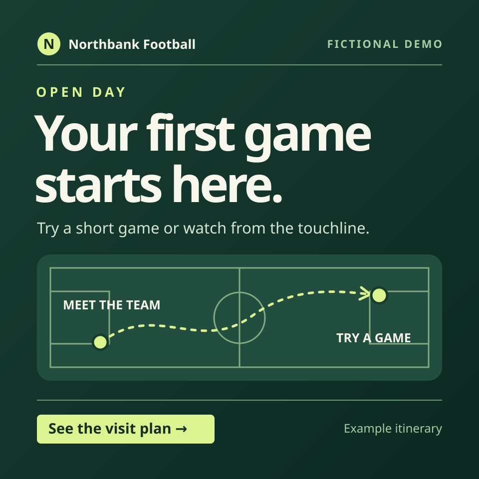

# Plan, check and hand over an open-day campaign

Use this fictional exercise to carry one campaign from approved copy to a review that another operator can run. The [public Northbank preview](https://shotclubhouse.github.io/shotos/open-day.html) is the reference design. The review records below are invented and do not change that public page.

Use [Campaign Website](../../packs/content/skills/campaign-website/README.md), [campaign graphics](../../packs/media/skills/image-create/campaign-graphics.md) and [Verify a Live Release](../../packs/setup/skills/verify-live-release/README.md). Keep one [work record](../../templates/work-record.md) for the copy, artwork, destination, checked revision and decisions.

## Round 1 · Prepare the draft

| ID | Record |
| --- | --- |
| N1 | Alex Reid, campaign owner, approved `Your first game starts here.` and `See the visit plan` for the fictional open-day page. The itinerary shows 10.00 at the welcome table and 10.20 for a short game. The page collects no signups or visitor details. |
| N2 | The editable pitch artwork belongs to the fictional campaign. A photograph of players was suggested, but its permission record is missing. |
| N3 | A volunteer suggests `Register now`, `free kit for every player` and `hundreds already signed up`. The campaign record contains no registration flow, kit offer or signup count. |
| N4 | Baseline observation sheet. Three of six volunteer reviewers could find the arrival time within 30 seconds from the previous draft. Alex agreed a target of at least five of six on the next preview. The check is a count from the review session. |

> Draft one hero headline and action, an editable square tile brief, and a short launch note for review. Cite N1–N4 in the work record. Link the destination and name what needs to be checked before publication. Keep campaign files and approval evidence separate.

### Review key

- The hero, tile and note make the same offer and route to the itinerary. The pitch artwork has a recorded source. Hold the photograph and the suggested promotional claims.
- Compare the [worked tile](open-day-tile.svg) with the [page hero](site/open-day.html). The square asset carries the action and fictional label. It keeps the arrival time in the itinerary so the reader has one source for logistics.
- On phone and desktop, check the hero and square at their intended sizes, then follow the itinerary action with the keyboard. In the work record, record the actual revision and whether the arrival time was found. Keep real publication and review approval open until there is evidence for each.

## Round 2 · Decide on release and ownership

Give the operator these records after they have written the draft.

| ID | Record |
| --- | --- |
| N5 | Five of six volunteers found the arrival time within 30 seconds on preview `P2`. A keyboard-only reviewer followed the action to the itinerary. The preview still showed 10.00. |
| N6 | The venue owner confirmed a 10.30 arrival. Alex approved revising the itinerary for review. There is no approval to publish the revised page. |
| N7 | Jamie Cole, receiving operator, can open the copy record, editable tile and preview. Jamie agreed to recheck the updated itinerary and record the result. No check of the new revision has been recorded. |

> Update the same work record. Report what N5 proves about P2, what to change for N6, and which checks Jamie owns. Separate the next review, publication approval, live result and the independent cycle.

### Review key

- P2 met the task-finding target. Record the result against P2 and repeat the critical checks on the new revision. Update the itinerary and any copy that quotes the time. The worked tile has no time to change.
- Mark the revised page ready for review only after its own checks. The release decision is pending Alex's approval for that exact revision. Jamie accepted the next review action. An independent cycle requires Jamie to complete it and leave evidence someone else can check.
- Once a release is authorised and published in a real project, check the exact public revision and action. For this exercise, keep the example site and connected channels as they are.
