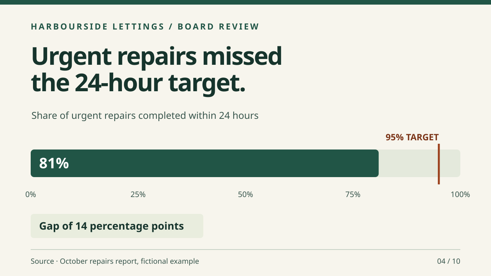

# slide-deck

**Reader and ask first, storyline before design, an editable deck, every number sourced, every slide looked at.**

The agent agrees who the deck is for and what they should do afterwards, writes one message per slide before it designs anything, builds in Google Slides or PowerPoint, and then renders every slide and checks it as an image. Overflowing text, mismatched numbers and empty placeholders are found before the meeting, not during it.

It supports the Operate stage. It serves rule 2 (agree acceptance first), rule 3 (read back the real result) and rule 4 (claim only what you can show).

## The problem it solves

An operations director asks for a ten-slide board update on a repairs backlog. The agent builds it in one go and reports "deck ready". On screen, slide 4 says the backlog is 212 jobs and slide 7 says 198, the chart on slide 5 is stretched, and the last slide still reads "Click to add title". The director finds all three in front of the board.

## What the agent does differently

The skill starts with the decision and sourced headlines. It checks the actual deck revision in the intended viewer. The [worked storyboard](../../examples/slide-deck/output.md) shows the difference between a quote, a target and evidence of results.

## When to use it, and when not to

Use it for pitches, board and team updates, training sessions, sales presentations and anything someone will stand up and present.

Do not use it for a long document nobody will present. Use [proposal-factory](../../../win-the-work/skills/proposal-factory/README.md) for many tailored decks and [contextual-proposal](../../../win-the-work/skills/contextual-proposal/README.md) for a reader-specific proposal.

## Who it is for

- **Executives and operations leaders:** board and team updates where the numbers must agree.
- **Founders and sales leads:** pitch and sales decks that land one ask.
- **Coaches and trainers:** session decks with speaker notes.
- **Small business owners:** a clear deck for the bank, a landlord or a local partner.

## How to use it

Install the content pack as described in the [pack README](../../README.md). Then ask:

> Make a ten-slide board update on the repairs backlog from the attached figures. The board needs to approve a temporary contractor. Google Slides, our template. Show me the storyline before you build it.

## How it connects

- **Before:** [written-content](../written-content/README.md) and [research-and-assemble](../../../../skills/research-and-assemble/README.md) gather and source the material.
- **Alongside:** [image-create](../../../media/skills/image-create/README.md) for visuals, and [voiceover](../../../media/skills/voiceover/README.md) to narrate a recorded version.
- **After:** [claims-audit](../../../trust/skills/claims-audit/README.md) before anything goes outside the organisation.

## Needs

- Google Slides through a connector, or PowerPoint files the agent can create and edit locally.
- A way to render slides as images, such as an export to PNG or PDF, so the agent can look at them.
- The owner's template or brand guide, if they have one.

**Evidence:** Tested in a paired run on 3 November 2026, one run per case, graded by meaning. Cases passed with SHOTos: Haiku 2 of 2, Sonnet 2 of 2, Opus 2 of 2. Without: Haiku 2 of 2, Sonnet 2 of 2, Opus 2 of 2. See [evidence](../../../../docs/evidence.md) for how to read this.

## Tips and common mistakes

- Write slide titles as messages. If a title is a topic, the slide has no point yet.
- Keep the editable original; export a PDF only to send.
- Check that the same number appears the same way on every slide.

## Limits

- The agent judges layout from rendered images; a person should still click through before a high-stakes meeting.
- Brand fit depends on the template and guide the owner supplies.

Files: [SKILL.md](SKILL.md) (for the agent), [template.md](template.md), [example input](../../examples/slide-deck/input.md) and [output](../../examples/slide-deck/output.md).
