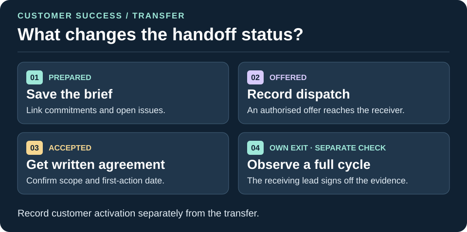

# customer-success pack

**Skills for handing an account to the person who will deliver for it, and for recovering an onboarding that has stalled.**

Both skills work from evidence, keep facts separate from opinions and draft any message for a person to send. They help a customer success lead, an account manager or a founder who is still doing both jobs.

## Who it is for

- Customer success and account managers who receive accounts from sales.
- Founders handing early customers to a first success hire.
- Delivery leads who find an onboarding has gone quiet.

## Skills



| Skill | Stage | What it does |
|---|---|---|
| [success-handoff](skills/success-handoff/README.md) | Own | Hands an account to the person who will deliver. Records Prepared, Offered, Accepted and Completed separately. |
| [onboarding-recovery](skills/onboarding-recovery/README.md) | Operate | Diagnoses where a stalled onboarding stopped, proposes the smallest next step to first value with an owner and date, and drafts the message. |

## Needs

Read-only first, and drafts instead of sends, throughout.

- **Mail connector:** read threads with the customer; create drafts. Sending is not needed and should stay off.
- **Calendar connector:** read meetings held and booked.
- **Document connector:** read account notes, proposals and onboarding plans; write the handoff record where the owner names.
- **Transcript connector:** read call transcripts, optional. Pasted notes work too.
- Without a connector, the skills work from pasted text and name what they could not check.

## Install

From your own project folder, with SHOTos cloned next to it:

```
python ../shotos/install.py --runtime claude --scope project --pack customer-success --dry-run
python ../shotos/install.py --runtime claude --scope project --pack customer-success
```

Use `--runtime codex` or `--runtime agents` for other agents, and repeat `--pack` to add several packs at once. To add a pack, use the same runtime and scope and name the extra pack. Existing files are kept.

Using the Claude app, ChatGPT or another chat assistant instead? See [where to run SHOTos](../../docs/running-it.md).

## How it connects

Both skills start from the account name. If the account has neither a proposal nor a controlling agreement, use [contextual-proposal](../win-the-work/skills/contextual-proposal/README.md) (or `bid-response` for a tender). An awarded tender or a live account with an agreement continues here. If the buyer writes about changed terms, use [email-reply](../win-the-work/skills/email-reply/README.md). The [North Quay worked deal](../win-the-work/skills/contextual-proposal/worked-deal.md) shows the shared record from proposal to accepted handoff.


Both skills apply the four rules in [docs/controls.md](../../docs/controls.md). The handoff follows the same idea as [evidence-handoff](../../skills/evidence-handoff/README.md): say what is known, from where, and what is not. The stages are in [docs/framework.md](../../docs/framework.md). In the win-the-work pipeline, LEAP's Plan sends the approved deal context to the delivery team. The account transfer uses the Own checks.
